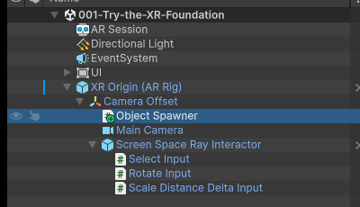
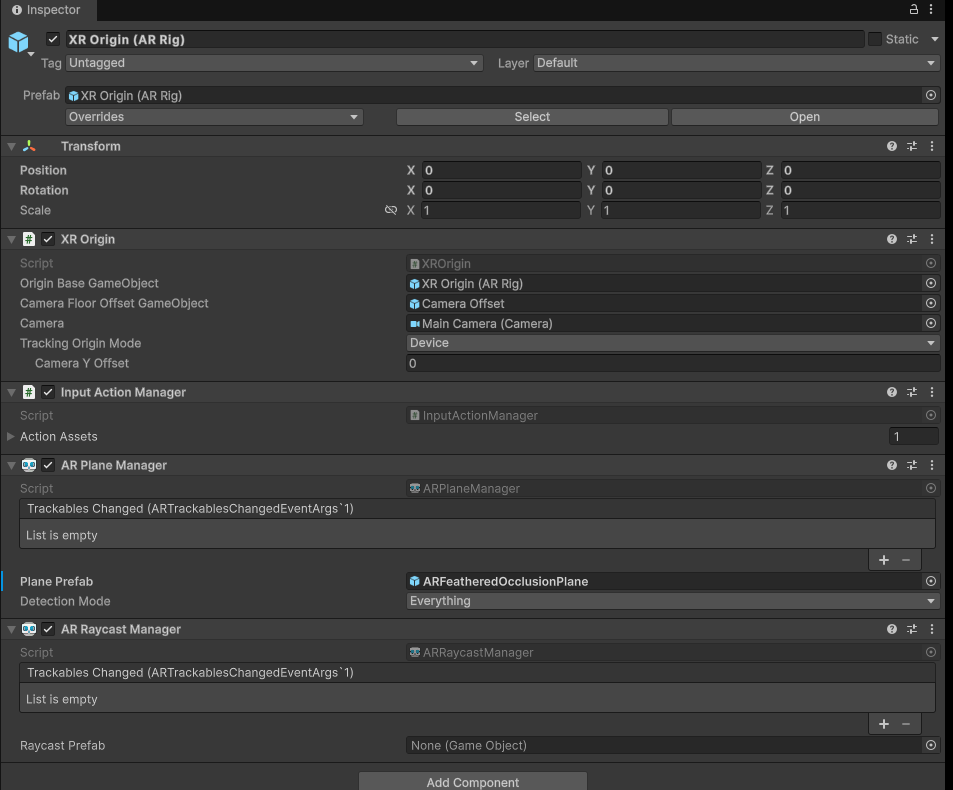
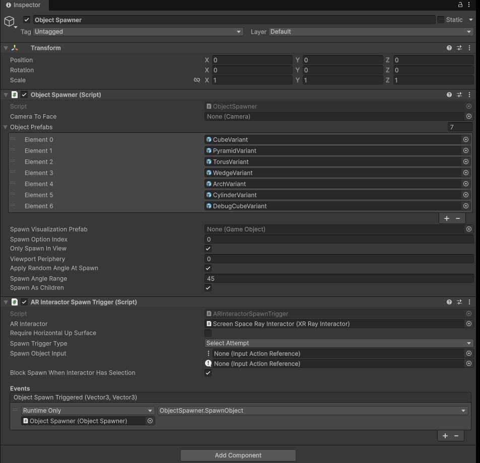

# Unity 001 – Try the XR Foundation

**What you will do:** Try the AR demo that comes ready-made in Unity's Mobile AR template. Tap the floor to place a shape, then move, rotate and scale it. There is nothing to build.
**XR concept:** The AR foundation: AR Session, XR Origin, plane detection and tap-to-place (Deck A006)
**Unity version:** Unity 6 (6000.x)
**Time:** about 10 minutes
**Code:** none

> **Status: draft.** Uses the scene `Assets/Scenes/001-Try-the-XR-Foundation` in the course project (`Unity/xr-course`). It is a try-out, so there is nothing to build. Screenshots are from the Editor; the Play-mode steps (3 to 5) were not captured.

## Why this step

Before you build with your own models, see what Unity gives you for free. Everything here is built in, so you only look and try.

## Steps

1. Open `Unity/xr-course` in Unity Hub and open the scene `Assets/Scenes/001-Try-the-XR-Foundation`.
2. Press **Play**. Click **Continue** on the welcome screen.
3. Look around: right mouse button and mouse, walk with **W A S D**. Dots appear on the floor. That is **plane detection**.
4. Pick a shape in the menu and click the floor. It appears where you tapped.
5. Click the shape to select it. Drag to move it, and use the simulated pinch and twist to scale and rotate it.
6. Stop Play. In the **Hierarchy**, find **AR Session**, **XR Origin** and **Object Spawner**. Select each and read its components.

## What to notice

| Part | What it does |
|------|--------------|
| **AR Session** | Runs the phone's tracking |
| **XR Origin** | Holds the camera and the detected floor |
| **AR Plane Manager** | Finds flat surfaces |
| **Object Spawner** | Places the chosen shape where you tap |

In the next step, [Unity 002 – Place the Heart](../002-place-the-heart/README.md), you bring in your own model.

## Credits

The demo is Unity's **Mobile AR** template and the **AR Starter Assets** sample. Both are from Unity.
