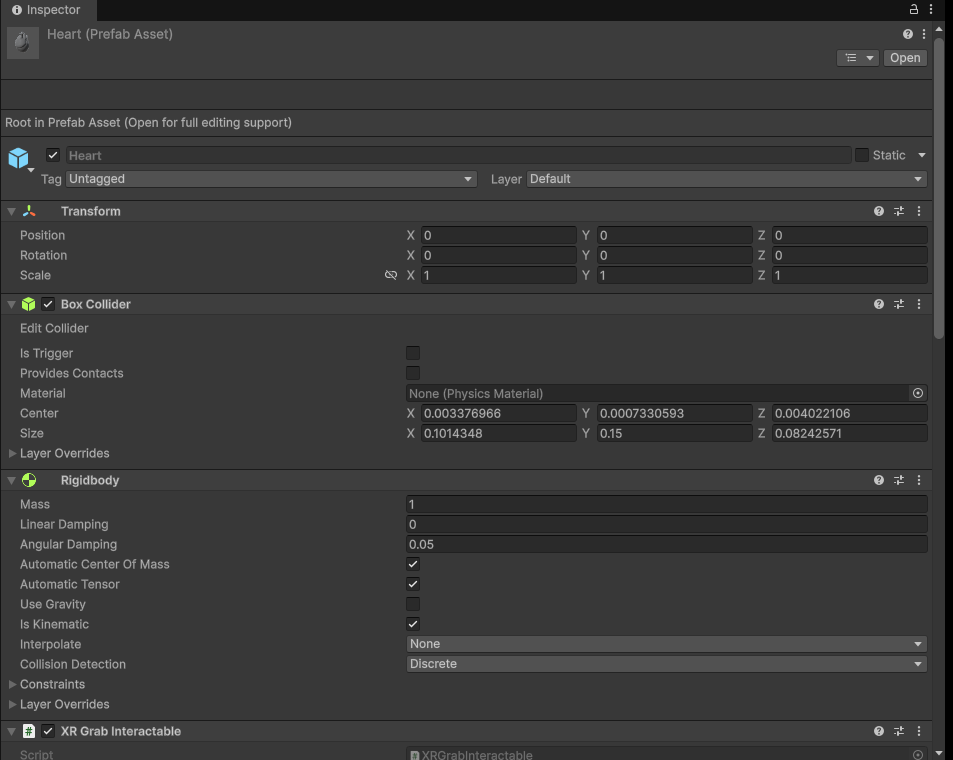
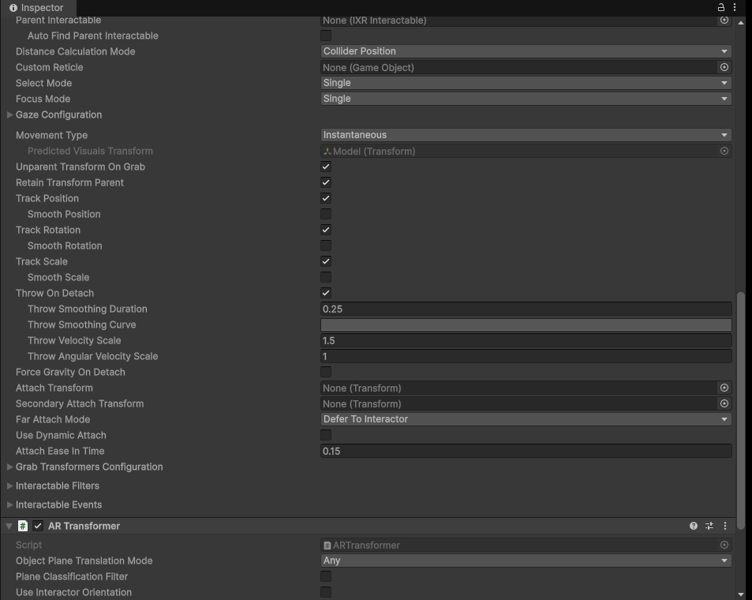
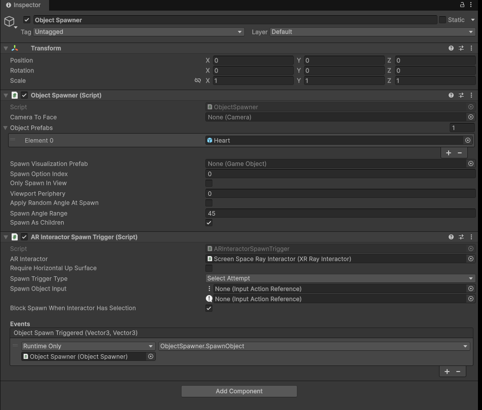

# Unity 002 – Place the Heart

**What you will build:** A markerless AR app. Tap the floor and a 3D human heart appears there. Drag to move it, twist with two fingers to rotate it and pinch to scale it.
**XR concept:** Plane detection and placing a model on a surface (Deck A003, markerless AR)
**Unity version:** Unity 6 (6000.x)
**Time:** about 25 minutes
**Code:** none

> **Status: draft.** The scene `Assets/Scenes/002-Place-the-Heart` in the course project (`Unity/xr-course`) is finished: `heart.fbx` is imported (`Assets/Shared/Models`), the `Heart` prefab (about 15 cm across, with a Box Collider, kinematic Rigidbody, XR Grab Interactable and AR Transformer) is in `Assets/Shared/Prefabs`, and the scene's Object Spawner places it. The steps below show how it was made, so participants can build it themselves. Built in Unity 6000.6.4f1; the prefab was rebuilt with the current components after the first version used deprecated ones. Not yet re-tested by touch or on a phone, and the Play-mode screenshot is still missing.

Do [Unity 000 – Set up](../000-setup/README.md) and [Unity 001 – Try the XR Foundation](../001-try-the-xr-foundation/README.md) first.

## What participants learn

- **Plane detection** finds the floor, and a tap is turned into a point on that plane.
- A **prefab** is a saved GameObject that the app can create many times.
- The **Object Spawner** creates a prefab where you tap.
- **Move, rotate and scale** by touch come from the XR Interaction Toolkit, with no code.
- Models have a real-world size. The heart must be scaled to a sensible size.

## Assets you need

- `Unity/assets/models/heart.fbx` ("Realistic Human Heart" by neshallads, CC BY 4.0, see [assets/README.md](../assets/README.md)). Its picture textures are inside the file. It is already in `Assets/Shared/Models/` in the course project.

## Steps

### Step 1 – Open the project

Open the course project `Unity/xr-course` in Unity Hub (**Add → Add project from disk**). Then open the scene `Assets/Scenes/002-Place-the-Heart`. To follow along from scratch, start from `001-Try-the-XR-Foundation`, use **File → Save As** to make your own copy, and work in that.

### Step 2 – Check the heart model

1. In the **Project** window open `Assets/Models` and click `heart`.
2. In the **Inspector**, open the **Materials** tab. If the materials look empty, click **Extract Textures** and **Extract Materials** and choose the `Models` folder.
3. Drag `heart` into the Scene view to look at it, then delete it from the Hierarchy again.

### Step 3 – Make a heart prefab

1. Drag `heart` from the Project window into the Hierarchy.
2. Make an **empty GameObject** (right-click in the Hierarchy → **Create Empty**), name it `Heart`, and drag the heart model into it. The empty parent is what the touch components move, so the model keeps its own size inside it.
3. Select the model and scale it until it is about 15 cm across. **1 unit is 1 metre in Unity.** For this FBX, a scale of about `0.016` works.
4. Select `Heart` (the parent) and click **Add Component**. Add these four, in this order:
   - **Box Collider**: click **Edit Collider** and fit it around the heart. Touch needs a collider to know where the heart is.
   - **Rigidbody**: tick **Is Kinematic** and untick **Use Gravity**, so the heart stays where you put it.
   - **XR Grab Interactable**: this lets you pick the object up with touch.
   - **AR Transformer**: this turns touch into move, rotate and scale on the AR floor.
5. Drag `Heart` from the Hierarchy into a new folder `Assets/Shared/Prefabs`. This makes the prefab. Delete the heart from the Hierarchy.

Why the prefab? The app needs a copy of the heart to make each time you tap. **XR Grab Interactable** plus **AR Transformer** is Unity's current way to move, rotate and scale AR objects with touch. (The older "AR Selection / Translation / Rotation / Scale Interactable" components are deprecated, so we do not use them.)

### Step 4 – Tell the spawner to use the heart

1. Select **Object Spawner** in the Hierarchy.
2. In the **Inspector**, find **Object Prefabs**. Set its size to `1` and drag the heart prefab into the slot.
3. Untick **Spawn Option → Random** (or set **Spawn Option** to **Fixed Index** `0`).
4. Optionally untick **Only Spawn in View** and **Apply Random Angle** so the heart always faces you.

### Step 5 – Test with XR Simulation

1. Press **Play**. Look around with the right mouse button and walk with **W A S D**.
2. Click the floor. The heart appears.
3. Click the heart to select it. Drag to move, and use the simulated pinch (hold **Ctrl** or use the simulator's touch panel) to scale.

## Test on a phone

### Android
Connect the phone with USB debugging on. In **File → Build Profiles** pick **Android**, click **Switch Platform** and then **Build and Run**.

### iPhone
Pick **iOS** in **Build Profiles** and **Build**. Open the result in Xcode on a Mac, set your team under **Signing** and run it on the phone.

## Make it your own

- Make a second prefab, for example a smaller heart with a different material.
- Change the heart's size and see how it feels on the floor.

## Troubleshooting

| Problem | Fix |
|---------|-----|
| The heart is huge or tiny | Change the Scale on the prefab. Models come in many sizes |
| The heart is white or pink | Extract the materials and textures (Step 2) |
| Tapping does nothing | Check the prefab is in **Object Prefabs** and the floor shows dots |
| Move, rotate or scale do not work | The prefab needs a Box Collider, a kinematic Rigidbody, an XR Grab Interactable and an AR Transformer |

## Credits

"Realistic Human Heart" by neshallads on Sketchfab, licensed under [CC Attribution 4.0](http://creativecommons.org/licenses/by/4.0/).
