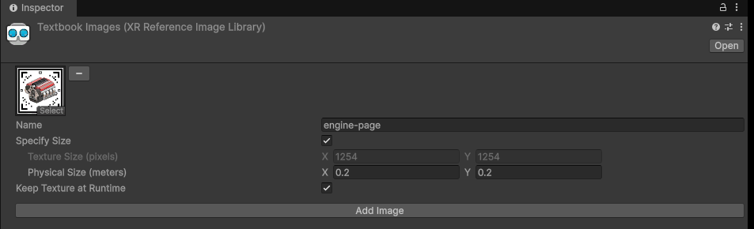
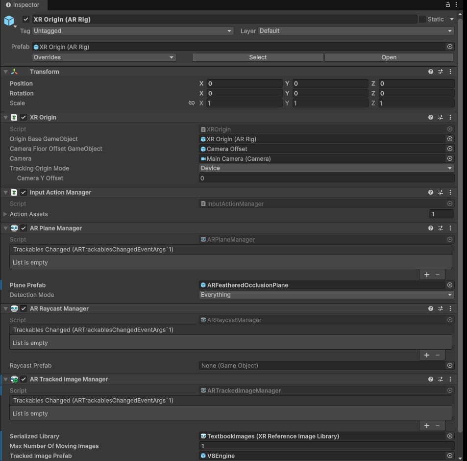

# Unity 003 – Textbook Pop-up

**What you will build:** An image-tracking AR app. Point the phone at a printed textbook page and an animated 3D V8 engine pops up on top of it.
**XR concept:** Image tracking and the reference image library (Deck A003)
**Unity version:** Unity 6 (6000.x)
**Time:** about 30 minutes
**Code:** none

> **Status: draft.** The finished scene `Assets/Scenes/003-Textbook-Pop-up` is in the course project ([`xr-course`](../xr-course/)). It opens and is set up, but it has **not been tried** with the tracked image in XR Simulation or on a phone. The steps are written from how the scene was built.

## Start and Final

- **Final:** the project `Unity/xr-course` has the finished scene. Open it to compare.
- **Start:** a new Mobile AR project plus `Unity/packages/XR-Course-Starter.unitypackage`. Drag the package into the **Project** window (or use **Assets → Import Package → Custom Package**) and click **Import**. It brings the models, textures and a clean `Start` scene. Open `Assets/Starter/Start`, then **File → Save As** `003-Textbook-Pop-up`.

## What participants learn

- **Image tracking** finds a known picture in the camera view and tells you where it is.
- A **Reference Image Library** is the list of pictures the app looks for. Each needs its **real printed size**.
- The **AR Tracked Image Manager** makes a copy of a prefab on every picture it finds.
- A model can carry its own **animation**, played by an **Animator**.

## Assets you need

All of these come in the Starter package (`Assets/Shared`):

- `Models/v8-engine.fbx`: "V8 Engine" by little.bucket, CC BY-NC 4.0 (non-commercial use only). It has built-in animation.
- `Textures/engine-marker.png`: the printed page used as the tracking picture, made for this course.
- `Textures/V8Engine/`: the picture textures that come with the engine.

See [assets/README.md](../assets/README.md) for credits.

## Steps

### Step 1 – Make a material for the engine

1. In the **Project** window, create the folder `Assets/003-Textbook-Popup`. Right-click it → **Create → Material**. Name it `V8Engine`.
2. In the **Inspector**, set **Base Map** to `initialShadingGroup_albedo` and **Normal Map** to `initialShadingGroup_normal` (both in `Assets/Shared/Textures/V8Engine`). If Unity asks to **Fix** the normal map, click it.

### Step 2 – Make the engine prefab

1. Make an empty GameObject named `V8 Engine` and drag `v8-engine` inside it.
2. Scale the model until it is about 15 cm across (for this model, about `0.018`). **1 unit is 1 metre.**
3. Assign the `V8Engine` material to the model's renderers.
4. The model has one animation clip. Select the model, add an **Animator**, and give it an **Animator Controller** (**Create → Animator Controller**) whose default state plays that clip. Tick **Loop Time** on the clip (in the model's **Animation** tab) so it repeats.
5. Drag `V8 Engine` into `Assets/Shared/Prefabs` and delete it from the scene.

### Step 3 – Make the image library

1. Right-click in `Assets/003-Textbook-Popup` → **Create → XR → Reference Image Library**. Name it `TextbookImages`.
2. Click **Add Image** and drag `engine-marker` into the slot.
3. Tick **Specify Size** and enter the printed size in metres. Our page is 0.2 by 0.2.

Why the size? Unity needs to know how big the picture really is, so it can tell how far away it is and place the engine at the right scale.

### Step 4 – Add the AR Tracked Image Manager

1. In the `Start` scene, select **Object Spawner** in the Hierarchy and untick it (turn it off), so tapping the floor does nothing.
2. Select **XR Origin (AR Rig)**, click **Add Component** and add **AR Tracked Image Manager**.
3. Drag `TextbookImages` into **Serialized Library**.
4. Set **Max Number Of Moving Images** to `1`.
5. Drag the `V8 Engine` prefab into **Tracked Image Prefab**.

### Step 5 – Test

- **On a phone:** print `engine-marker.png` about 20 cm wide (or show it on a second screen). Build to the phone (see below) and point the camera at it. The engine appears on the page and plays its animation.
- **In the Editor:** XR Simulation can also track images. In the Final project the engine page lies on the table of the simulated room for this scene (`Assets/Shared/SimulationEnvironments/Table-With-Engine-Page`). The script `Assets/Shared/Editor/SceneEnvironment.cs` picks the right room for each lesson when you press Play.

## Test on a phone

### Android
Connect the phone with USB debugging on. In **File → Build Profiles** pick **Android**, click **Switch Platform**, add the open scene with **Add Open Scenes**, then **Build and Run**.

### iPhone
Pick **iOS** in **Build Profiles**, add the open scene and **Build**. Open the result in Xcode on a Mac, choose your team under **Signing** and run it.

## Make it your own

- Add a second picture to the library (for example a page of your own) and a second prefab for it.
- Change **Max Number Of Moving Images** and watch what happens when you hold two pictures in view.

## Troubleshooting

| Problem | Fix |
|---------|-----|
| Nothing appears on the page | Check the library is assigned, the prefab is assigned and **Specify Size** matches the print |
| The engine is huge or tiny | Check the printed size matches the number you entered, then scale the prefab |
| The engine is white or pink | Re-check the material in Step 1 |
| The engine does not move | The Animator needs a controller with the clip as its default state |

## Credits

"V8 Engine" by little.bucket on Sketchfab, licensed under [CC Attribution-NonCommercial 4.0](http://creativecommons.org/licenses/by-nc/4.0/).
