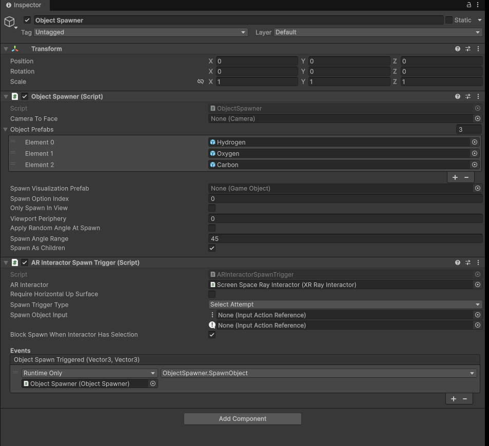
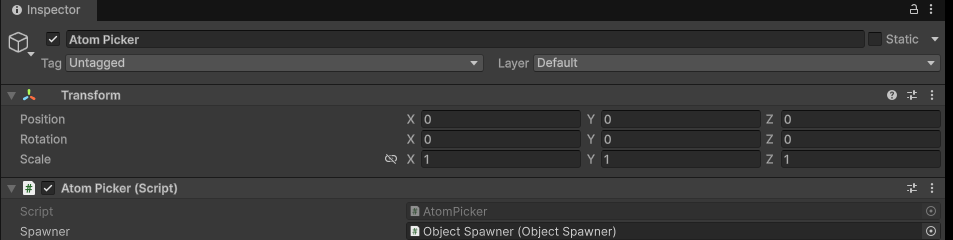
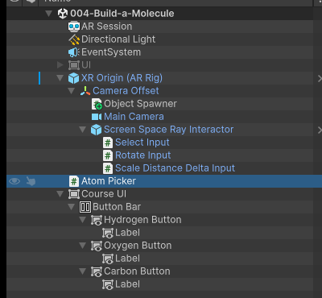
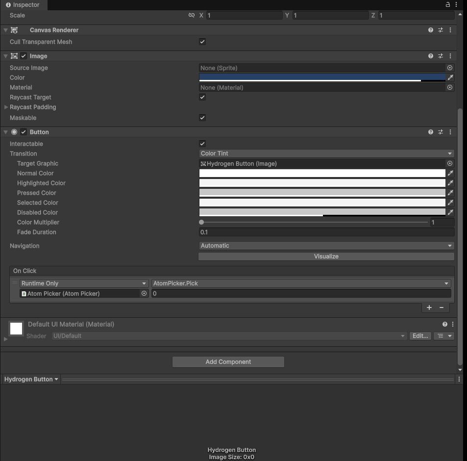

# Unity 004 – Build a Molecule

**What you will build:** An AR app with a three-button menu: **Hydrogen**, **Oxygen** and **Carbon**. Pick an atom, tap the floor to place it, then move the atoms together to build a molecule such as water (one oxygen and two hydrogens).
**XR concept:** Placing different models, and a simple screen menu (Deck A004, chemistry and science education)
**Unity version:** Unity 6 (6000.x)
**Time:** about 40 minutes
**Code:** one 5-line script

> **Status: draft.** The finished scene `Assets/Scenes/004-Build-a-Molecule` is in the course project ([`xr-course`](../xr-course/)). It was checked in Play mode in the Editor: the three buttons are wired, and picking each atom and tapping spawns Hydrogen, Oxygen and Carbon with no console errors. It has **not been tried by touch or on a phone**.

## Start and Final

- **Final:** open `Unity/xr-course` and the scene `004-Build-a-Molecule` to compare.
- **Start:** a Mobile AR project with `Unity/packages/XR-Course-Starter.unitypackage` imported (see [lesson 000](../000-setup/README.md)). Open `Assets/Starter/Start`, then **File → Save As** `004-Build-a-Molecule`.

## What participants learn

- The **Object Spawner** can hold a **list** of prefabs and spawns the one at **Spawn Option Index**.
- **Spawn Option Index** is just a number, so a button can change it.
- A **Canvas** with **Buttons** makes an on-screen menu, and **On Click** calls a method on any object.
- A tiny script is the glue between a button and the spawner.

## Assets you need

None are imported. The atoms are built from Unity's own **Sphere**, so no model files are needed. The script is below.

## Steps

### Step 1 – Make the three atoms

Do this once for each atom. We use these sizes and colours:

| Atom | Colour | Diameter |
|------|--------|----------|
| Hydrogen | white | 3 cm |
| Oxygen | red | 5 cm |
| Carbon | dark grey | 4.5 cm |

1. Create the folder `Assets/004-Build-a-Molecule`. Right-click → **Create → Material** and make three materials named `Hydrogen`, `Oxygen` and `Carbon`. Set each **Base Map** colour.
2. In the Hierarchy make an **empty GameObject** named `Hydrogen`. Right-click it → **3D Object → Sphere** to add a child, scale the sphere to `0.03` and delete the sphere's own **Sphere Collider**. Drag the material onto it.
3. On the parent `Hydrogen`, click **Add Component** and add, in this order: **Sphere Collider** (set Radius to half the diameter, `0.015`), **Rigidbody** (tick **Is Kinematic**, untick **Use Gravity**), **XR Grab Interactable** and **AR Transformer**. This is the same set as the heart in [lesson 002](../002-place-the-heart/README.md).
4. Drag `Hydrogen` into `Assets/Shared/Prefabs`, then delete it from the scene.
5. Repeat for `Oxygen` and `Carbon`.

### Step 2 – Put the atoms in the spawner

1. Select **Object Spawner** (inside **XR Origin → Camera Offset**).
2. Set **Object Prefabs** to size `3` and drag in `Hydrogen`, `Oxygen`, `Carbon`, in that order. Element 0 is Hydrogen, 1 is Oxygen and 2 is Carbon.
3. Untick **Apply Random Angle At Spawn** and **Only Spawn In View**.



### Step 3 – The script

In `Assets/Shared/Scripts` create a C# script named `AtomPicker` and replace its content with:

```csharp
using UnityEngine;
using UnityEngine.XR.Interaction.Toolkit.Samples.StarterAssets;

public class AtomPicker : MonoBehaviour
{
    public ObjectSpawner spawner;
    public void Pick(int index) { spawner.spawnOptionIndex = index; }
}
```

What each part does:

- **Line 2:** brings in the `ObjectSpawner` type from the XR Interaction Toolkit sample.
- **Line 6:** a slot in the Inspector where we drag the spawner.
- **Line 7:** a method `Pick`. When a button calls it with a number, it tells the spawner which prefab to use next.

Make an empty GameObject named `Atom Picker`, add the `AtomPicker` script, and drag **Object Spawner** into its **Spawner** slot.





### Step 4 – The menu

1. Right-click in the Hierarchy → **UI → Canvas**. Name it `Course UI`. In **Canvas Scaler** set **UI Scale Mode** to **Scale With Screen Size** and **Reference Resolution** to `1080 × 1920`.
2. Add an empty child `Button Bar` with a **Horizontal Layout Group** (spacing 24, tick **Control Child Size** for width and height, **Child Force Expand** on). Anchor it to the bottom of the screen, about 220 tall.
3. Inside it add three **UI → Button – TextMeshPro** buttons named `Hydrogen`, `Oxygen` and `Carbon` and change their text. (Unity may offer to import **TMP Essentials**: click **Import**.)

### Step 5 – Connect the buttons

For each button, find **On Click ()** in the Inspector and click **+**. Drag the `Atom Picker` object into the slot, choose **AtomPicker → Pick (int)**, and type the number: `0` for Hydrogen, `1` for Oxygen, `2` for Carbon.



### Step 6 – Test

Press **Play**, tap an atom button, then tap the floor. Pick another atom and tap again. Build water: one oxygen with two hydrogens touching it. Drag atoms with one finger to move them.

## Test on a phone

### Android
Connect the phone with USB debugging on. **File → Build Profiles** → **Android** → **Switch Platform** → **Add Open Scenes** → **Build and Run**.

### iPhone
**Build Profiles** → **iOS** → **Add Open Scenes** → **Build**. Open the result in Xcode on a Mac, choose your team under **Signing** and run it.

## Make it your own

- Add a **Nitrogen** atom (blue) and a fourth button.
- Try building carbon dioxide or methane.
- Change the atom sizes. Real atoms are all very different sizes, so what would be more accurate?

## Troubleshooting

| Problem | Fix |
|---------|-----|
| Every tap places the same atom | Check each button's **On Click** has a different number |
| A button does nothing | The **Atom Picker** slot is empty, or the **Spawner** slot on it is empty |
| Tapping a button also places an atom | The menu must be on a Canvas with an **EventSystem** in the scene (the template has one) |
| The atoms cannot be moved | The prefab needs the collider, Rigidbody, XR Grab Interactable and AR Transformer |

## Credits

All parts are Unity built-in primitives and the template's sample components.
