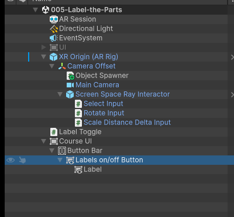
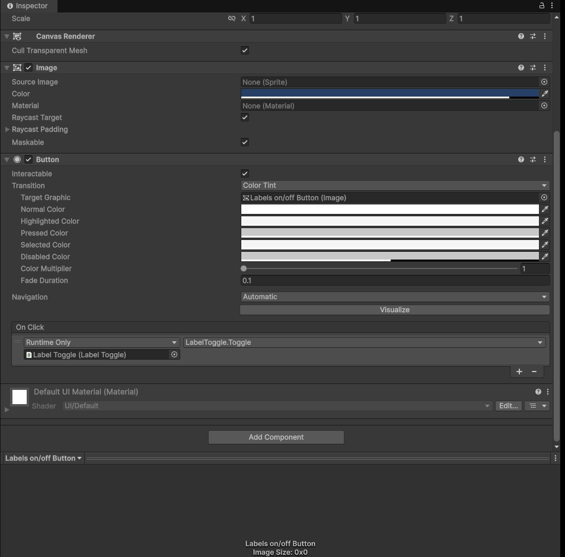

# Unity 005 – Label the Parts

**What you will build:** The AR heart again, now with four floating name labels (Aorta, Pulmonary artery, Left ventricle, Right atrium). The labels always turn to face you, and one button turns them on and off.
**XR concept:** World-space labels in AR, and billboards (Deck A004, anatomy)
**Unity version:** Unity 6 (6000.x)
**Time:** about 35 minutes
**Code:** two short scripts (5 lines and 8 lines)

> **Status: draft.** The finished scene `Assets/Scenes/005-Label-the-Parts` is in the course project ([`xr-course`](../xr-course/)). Checked in Play mode in the Editor: the labelled heart spawns, there are 4 visible labels, the toggle takes them to 0 and back to 4, and there are no console errors. The label **positions are approximate** and have not been checked on screen against the heart's anatomy. Not tried by touch or on a phone.

## Start and Final

- **Final:** open `Unity/xr-course` and the scene `005-Label-the-Parts`.
- **Start:** a Mobile AR project with `Unity/packages/XR-Course-Starter.unitypackage` imported ([lesson 000](../000-setup/README.md)). Open `Assets/Starter/Start`, then **File → Save As** `005-Label-the-Parts`.

## What participants learn

- **World-space text** (TextMeshPro, the 3D one) lives in the scene, like any object, instead of on the screen.
- Children move, rotate and scale with their parent, so labels stay with the heart when you move it.
- A **billboard** is something that always faces the camera.
- A button can switch many objects on and off.

## Assets you need

- `Assets/Shared/Prefabs/Heart` from [lesson 002](../002-place-the-heart/README.md) (it comes with the model in the Starter package). The scripts are below.

## Steps

### Step 1 – Make a labelled heart

1. Drag the `Heart` prefab into the Hierarchy and **Unpack Completely** (right-click → **Prefab → Unpack Completely**). Rename it `Heart Labeled`.
2. Add an empty child named `Labels`.
3. Inside `Labels`, right-click → **3D Object → Text – TextMeshPro**. Do this four times. Name and place them (positions are in metres from the heart's centre):

| Label | Position (X, Y, Z) |
|-------|--------------------|
| Aorta | 0.02, 0.09, 0 |
| Pulmonary artery | −0.05, 0.08, 0.02 |
| Left ventricle | 0.07, −0.02, 0 |
| Right atrium | −0.08, 0.01, 0 |

4. On each label set the **Text**, **Font Size** to `0.25`, **Alignment** to centre, **Wrapping** to **Disabled**, and set the **Rect Transform** width and height to `0.2` × `0.05`.
5. Drag `Heart Labeled` into `Assets/Shared/Prefabs` and delete it from the scene.

Why so small? The heart is only 15 cm across, and 1 unit is 1 metre, so a label 2 cm tall needs a tiny font size.

### Step 2 – Make the labels face you

Create a C# script named `LabelBillboard` in `Assets/Shared/Scripts`:

```csharp
using UnityEngine;

public class LabelBillboard : MonoBehaviour
{
    void LateUpdate() { transform.forward = transform.position - Camera.main.transform.position; }
}
```

- **`LateUpdate`** runs every frame after everything else has moved.
- **`transform.position - Camera.main.transform.position`** is the direction from the camera to the label. Setting the label's `forward` to that makes the text's back face the camera, which is how TextMeshPro text is read the right way round.

Add this script to **each of the four labels**.

### Step 3 – The toggle script

Create a second script `LabelToggle`:

```csharp
using UnityEngine;

public class LabelToggle : MonoBehaviour
{
    bool show = true;
    public void Toggle()
    {
        show = !show;
        foreach (var l in FindObjectsByType<LabelBillboard>(FindObjectsInactive.Include, FindObjectsSortMode.None))
            l.gameObject.SetActive(show);
    }
}
```

- **`bool show`** remembers whether the labels are on.
- **`Toggle`** flips it, then finds every `LabelBillboard` in the scene (including hidden ones) and switches those objects on or off. This works for hearts that are placed *after* the scene started, because the search happens when the button is pressed.

Make an empty object `Label Toggle` and add the `LabelToggle` script to it.

### Step 4 – Set the spawner and menu

1. Select **Object Spawner**: set **Object Prefabs** to size `1` and drag `Heart Labeled` in. Untick **Apply Random Angle At Spawn** and **Only Spawn In View**.
2. Make a Canvas `Course UI` with a **Button Bar** and one button labelled `Labels on/off`, exactly as in [lesson 004](../004-build-a-molecule/README.md) step 4.



### Step 5 – Connect the button

Select the button. In **On Click ()** click **+**, drag the `Label Toggle` object into the slot and choose **LabelToggle → Toggle ()**.



### Step 6 – Test

Press **Play**, tap the floor to place the heart, walk around it and watch the labels turn to face you. Press the button: the labels disappear. Press again: they come back.

## Test on a phone

### Android
Connect the phone with USB debugging on. **File → Build Profiles** → **Android** → **Switch Platform** → **Add Open Scenes** → **Build and Run**.

### iPhone
**Build Profiles** → **iOS** → **Add Open Scenes** → **Build**. Open in Xcode on a Mac, choose your team under **Signing** and run.

## Make it your own

- Move the labels so each one touches the right part of the heart (compare with a diagram).
- Add a fifth label, such as **Vena cava**.
- Change the label colour or size.

## Troubleshooting

| Problem | Fix |
|---------|-----|
| The labels are huge or invisible | TextMeshPro **Font Size** is in world units here: try `0.25` |
| The text is mirrored | Check the `LabelBillboard` script line exactly as above |
| The button does nothing | The `Label Toggle` object is missing from the **On Click** slot |
| The labels do not come back after switching off | Make sure the **Include** option is in `FindObjectsInactive.Include` |

## Credits

"Realistic Human Heart" by neshallads on Sketchfab, licensed under [CC Attribution 4.0](http://creativecommons.org/licenses/by/4.0/).
