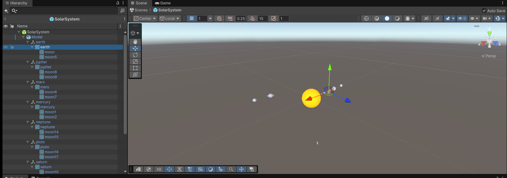
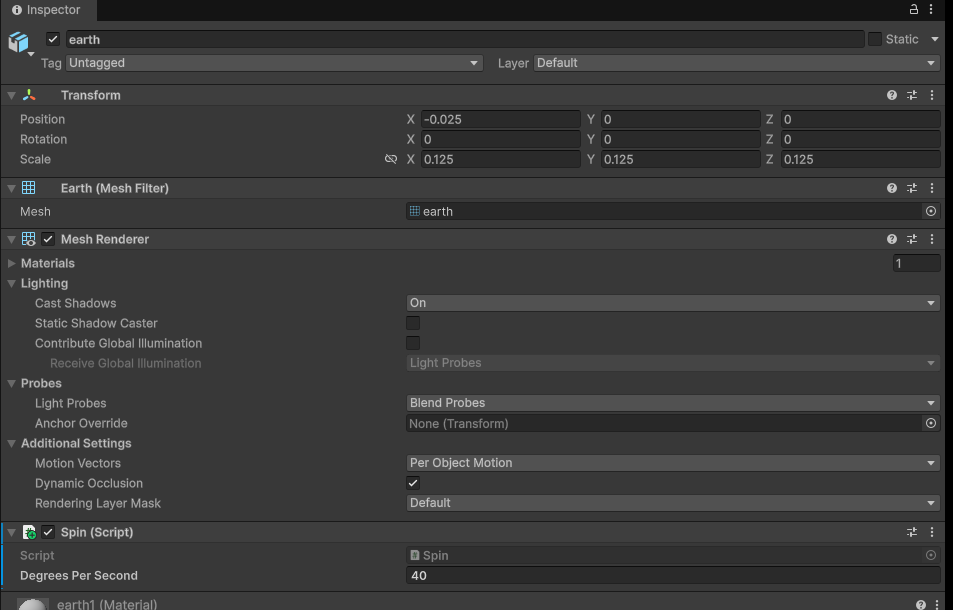
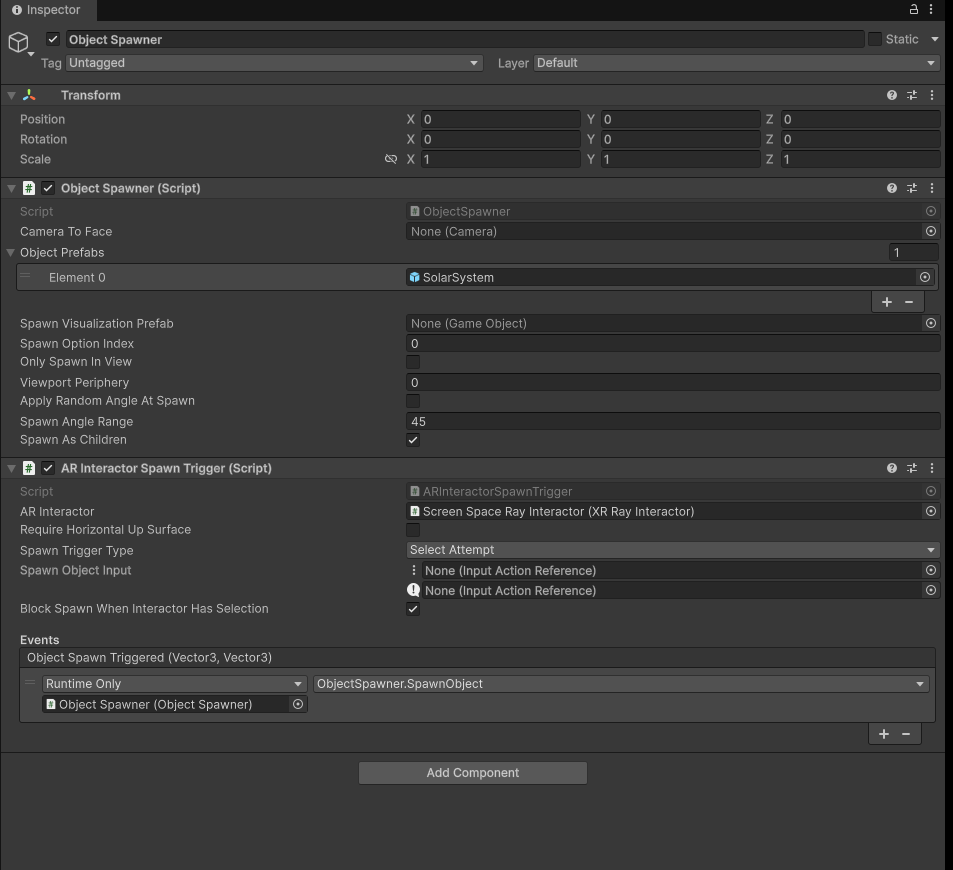

# Unity 006 – Solar System on the Table

**What you will build:** A model of the solar system you place on the floor or a table. The planets circle the middle, and each planet also spins on its own axis.
**XR concept:** Parent and child objects, animation and scale (Deck A004, astronomy and science education)
**Unity version:** Unity 6 (6000.x)
**Time:** about 35 minutes
**Code:** one 5-line script

> **Status: draft.** The finished scene `Assets/Scenes/006-Solar-System-on-the-Table` is in the course project ([`xr-course`](../xr-course/)). Checked in Play mode in the Editor: the solar system spawns, it has 9 spinning planets and no console errors. It was **not checked** that the orbit animation visibly plays, and it has not been tried by touch or on a phone.

## Start and Final

- **Final:** open `Unity/xr-course` and the scene `006-Solar-System-on-the-Table`.
- **Start:** a Mobile AR project with `Unity/packages/XR-Course-Starter.unitypackage` imported ([lesson 000](../000-setup/README.md)). Open `Assets/Starter/Start`, then **File → Save As** `006-Solar-System-on-the-Table`.

## What participants learn

- **Parent and child:** each planet sits inside a "pivot" object. Turning the pivot makes the planet **orbit**. Turning the planet itself makes it **spin**.
- A model can carry an **animation clip** that plays on its own through an **Animator**.
- A tiny script can make anything spin.
- **Scale** decides how big the model is on the table. 1 unit is 1 metre.

## Assets you need

All in the Starter package:

- `Assets/Shared/Models/solar-system.fbx`: "Solar System" by NANDA KUMAR, CC BY 4.0. It has a built-in animation of the planets orbiting.
- `Assets/Shared/Textures/SolarSystem/`: the planet pictures that come with the model.

See [assets/README.md](../assets/README.md) for credits.

## Steps

### Step 1 – Look at the model

Drag `solar-system` into the scene and open it up in the Hierarchy. Each planet has a **pivot** with the planet's name (for example `earth`), and the planet itself is a child with the same name inside it. The moons are children of the planet.

Why? When the model's animation turns the pivot, everything inside it, planet and moons, travels around the middle.

### Step 2 – Make the animation loop

1. Click `solar-system.fbx` in the Project window and open the **Animation** tab in the Inspector.
2. Tick **Loop Time** on the clip and click **Apply**.

### Step 3 – Make it play

1. Make an empty GameObject `Solar System` and drag the model inside it.
2. Select the model and add an **Animator**.
3. Right-click in `Assets/006-Solar-System` → **Create → Animator Controller**. Open it, drag the model's clip into the graph so it is the orange **default** state, and assign the controller to the Animator.

### Step 4 – The spin script

Create a C# script named `Spin` in `Assets/Shared/Scripts`:

```csharp
using UnityEngine;

public class Spin : MonoBehaviour
{
    public float degreesPerSecond = 30f;
    void Update() { transform.Rotate(0, degreesPerSecond * Time.deltaTime, 0); }
}
```

- **`degreesPerSecond`** shows up in the Inspector so you can change the speed.
- **`Update`** runs every frame. **`Time.deltaTime`** is the time since the last frame, so the speed is the same on every phone.
- **`transform.Rotate(0, ..., 0)`** turns the object around its up axis (Y).

Add the script to each **planet** (the inner object with the mesh, not the pivot). Set **Degrees Per Second** to `40`. Do not add it to the moons.





### Step 5 – Make it a prefab you can place

1. On `Solar System`, add a **Box Collider** (fit it around the planets), a **Rigidbody** (**Is Kinematic**, no gravity), **XR Grab Interactable** and **AR Transformer**, as for the heart in [lesson 002](../002-place-the-heart/README.md). The finished model is about 40 cm across and 8 cm tall.
2. Drag `Solar System` into `Assets/Shared/Prefabs` and delete it from the scene.
3. Select **Object Spawner**: set **Object Prefabs** to size `1` and drag in `Solar System`. Untick **Apply Random Angle At Spawn** and **Only Spawn In View**. Turn off the template's **UI** object.



### Step 6 – Test

Press **Play**, tap the floor and watch the planets. Pinch to scale it up so it fills a table, or down so it fits in your hand.

## Test on a phone

### Android
Connect the phone with USB debugging on. **File → Build Profiles** → **Android** → **Switch Platform** → **Add Open Scenes** → **Build and Run**.

### iPhone
**Build Profiles** → **iOS** → **Add Open Scenes** → **Build**. Open in Xcode on a Mac, choose your team under **Signing** and run.

## Make it your own

- Make Jupiter spin fast and Venus very slowly (Venus really does spin backwards, so try a negative number).
- Make the whole system twice as big.
- Add a **Sun** in the middle: a yellow sphere. (The model does not include one.)

## Troubleshooting

| Problem | Fix |
|---------|-----|
| The planets do not orbit | The Animator needs the controller, and the controller needs the clip as its default state |
| The orbit stops after one go | Tick **Loop Time** on the clip (Step 2) |
| The planets orbit but do not spin | Add `Spin` to the inner planet objects, not the pivots |
| The system is tiny or huge | Pinch to scale, or change the prefab's scale |

## Credits

"Solar System" by NANDA KUMAR (@Nandakumar000) on Sketchfab, licensed under [CC Attribution 4.0](http://creativecommons.org/licenses/by/4.0/). [Original model](https://sketchfab.com/3d-models/solar-system-b6b69a95a6f0426bb8bbc2e8cb7ff46a)
