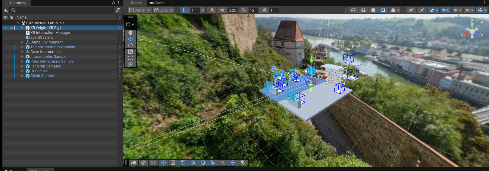
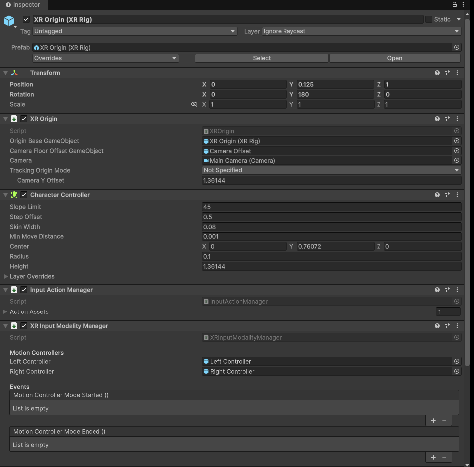

# Unity 007 – Virtual Lab Visit (VR)

**What you will build:** A VR scene. You stand on a platform high above a real fortress view (a 360° photo as the sky), with teleport movement and objects you can pick up and press. This is the VR demo of the course.
**XR concept:** 6DoF VR, teleport movement, grabbing and comfort first (Deck A007)
**Unity version:** Unity 6 (6000.x)
**Time:** about 30 minutes
**Code:** none

> **Status: draft.** The finished scene `Assets/Scenes/007-Virtual-Lab-Visit` is in the course project ([`xr-course`](../xr-course/)). It opens, shows the fortress sky and has no missing scripts or references. Entering Play mode produced no console errors. It has **not been tried with a headset or the XR Device Simulator**, and the course project is set up for AR, so a headset build needs the VR settings below.

## Start and Final

- **Final:** open `Unity/xr-course` and the scene `007-Virtual-Lab-Visit`.
- **Start:** a Mobile AR project (the Mobile AR template includes the **Starter Assets** sample used here) with `Unity/packages/XR-Course-Starter.unitypackage` imported ([lesson 000](../000-setup/README.md)). Open the sample scene `Assets/Samples/XR Interaction Toolkit/<version>/Starter Assets/DemoScene`, then **File → Save As** `007-Virtual-Lab-Visit`.

## What participants learn

- A VR scene has an **XR Origin (XR Rig)**: the camera and the two hand controllers.
- **Teleportation** moves you by pointing at a spot and releasing, which is the most comfortable way to move in VR.
- **Grab, poke and UI interactions** let you pick up objects, press buttons and use menus.
- A **skybox** can be a 360° photo, which makes a place feel real without building it.
- **Comfort:** short moves (teleport), snap turning and a **tunnelling vignette** (the screen edges darken when moving) all reduce motion sickness.

## Assets you need

- The **Starter Assets** sample of the XR Interaction Toolkit (already in the Mobile AR template under `Assets/Samples`). It contains the demo scene, the rig and the interaction examples.
- `Assets/Shared/Textures/Heritage/panorama-fortress.jpg`: "Veste Oberhaus (Passau, full spherical panoramic image)" by Jürgen Matern, CC BY-SA 4.0. Resized and turned so the castle is straight ahead.

See [assets/README.md](../assets/README.md) for credits.

## Steps

### Step 1 – Open the demo scene

Open the Starter Assets `DemoScene`, then **File → Save As** `007-Virtual-Lab-Visit`. Look in the Hierarchy: **XR Origin (XR Rig)** is you, **Teleportation Environment** is the floor you can teleport on, and the **Interactables**, **Poke**, **Far Grab**, **UI** and **Climb** samples are the things to try.

### Step 2 – Add the fortress sky

1. Create the folder `Assets/007-Virtual-Lab-Visit`. Right-click → **Create → Material** and name it `FortressSky`.
2. In the Inspector set the **Shader** to **Skybox → Panoramic**.
3. Drag `panorama-fortress` into **Spherical (HDR)** and set **Mapping** to **Latitude Longitude Layout**.
4. Open **Window → Rendering → Lighting**, find **Environment → Skybox Material** and drag `FortressSky` in.

### Step 3 – Look at the rig

Select **XR Origin (XR Rig)**. It has an **XR Origin** component, and under it the **Main Camera** and the **Left** and **Right Controller**. The controllers carry the **Ray**, **Poke**, **Grab** and **Teleport** interactors.

### Step 4 – Check the comfort options

Open **XR Origin (XR Rig)** and find the **Locomotion** object. Its children are the ways to move: **Move**, **Turn**, **Teleportation**, **Grab Move**, **Climb**, **Gravity** and **Jump**. For the most comfortable experience untick (turn off) **Move**, which is smooth walking, and keep **Teleportation** and **Turn**. In the **Turn** object you can choose snap turning (jumps in steps) instead of smooth turning. The demo scene also uses a **tunnelling vignette** (the screen edges darken while you move); look for it in the Hierarchy.

### Step 5 – Test

- **With a headset:** go to **Edit → Project Settings → XR Plug-in Management**, tick **OpenXR** on the **PC** tab (or **Android** for a standalone headset) and press **Play**.
- **Without a headset:** import the **XR Device Simulator** from **Window → Package Manager → XR Interaction Toolkit → Samples** and drag its prefab into the scene. It lets you move and use the hands with the keyboard and mouse; its on-screen help lists the keys.

> The course project uses **XR Simulation** for AR. Switching to OpenXR for VR turns the AR simulation off, so switch back before testing the AR lessons.

## Make it your own

- Replace the panorama with your own 360° photo.
- Move or add a teleport area.
- Add your own object and make it grabbable with an **XR Grab Interactable**.

## Troubleshooting

| Problem | Fix |
|---------|-----|
| The sky is grey | Check the Skybox Material is assigned in the Lighting window |
| The photo looks stretched or upside down | Set **Mapping** to **Latitude Longitude Layout** |
| Nothing happens in Play mode | Without a headset you need the **XR Device Simulator** |
| The AR scenes stop working in the Editor | Switch the PC **XR Plug-in Management** back to **XR Simulation** |

## Credits

- XR Interaction Toolkit **Starter Assets** sample, from Unity.
- "Veste Oberhaus (Passau, full spherical panoramic image, equirectangular projection)" by Jürgen Matern (2018), licensed under [CC Attribution-ShareAlike 4.0](https://creativecommons.org/licenses/by-sa/4.0/). Shared here under the same licence. [Original picture](https://commons.wikimedia.org/wiki/File:Veste_Oberhaus_(Passau,_full_spherical_panoramic_image,_equirectangular_projection).jpg)
