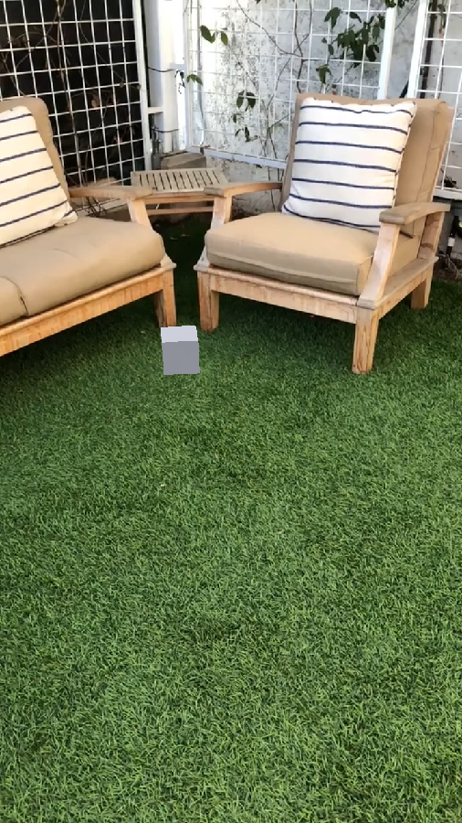

# Lens 1 – 3D Axis Explorer

**What you will build:** A world lens that drops a cube with red X, green Y and blue Z arrows. Pinch to move, rotate and scale it.
**XR concept:** World tracking, 3D coordinates and transforms (Deck 1 spatial concepts)
**Course day:**
**Lens Studio version:**
**Time:** about __ minutes

## Assets you need
From `lens-studio/assets/`:
- `models/...`
- `textures/...`

## Steps

### Step 1 – Create a new project
What to click and what you should see.

### Step 2 – …

## Test on your phone
How to pair Lens Studio with Snapchat and preview.

## Make it your own
Ideas for participants to change or extend the lens.

## Troubleshooting
| Problem | Fix |
|---------|-----|
