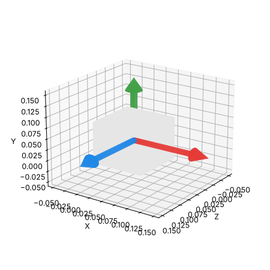

# Lens 1 – 3D Axis Explorer

**What you will build:** A world lens that drops a cube with red X, green Y and blue Z arrows into the room. Drag to move it, pinch to scale it and twist with two fingers to rotate it.
**XR concept:** World tracking, 3D coordinates and transforms (Deck 1 spatial concepts)
**Course day:** Day 1
**Lens Studio version:** 5.25 (Windows and macOS)
**Time:** about 20 minutes

> **Status: draft.** The steps are written for Lens Studio 5.25 and are being checked on Windows and macOS. Screenshots will be added as each step is confirmed.

## What participants learn

- Every object in a 3D scene has a **position, rotation and scale**, measured along three axes.
- The colour code used in Lens Studio, Unity, Blender and most 3D tools: **X is red (right), Y is green (up), Z is blue (towards you)**.
- In Lens Studio, **1 unit is 1 centimetre**.
- **World tracking** keeps a virtual object fixed in the real room while you move your phone around it.

## Assets you need

From `lens-studio/assets/models/`:

- `axis-cube.glb` – a 10 cm grey cube with three 15 cm arrows: red X, green Y, blue Z. The arrows start at the centre of the cube, so the cube's centre is the origin (0, 0, 0).

## Steps

### Step 1 – Create a new project

1. Open Lens Studio 5.25.
2. On the Home screen, start a new blank project.
3. Save it straight away (**File → Save As**) as `3d-axis-explorer` inside this lens's `project/` folder.

You should see the Scene Hierarchy (left), the Scene view (centre), the Preview (right), the Inspector and the Asset Browser.

### Step 2 – Turn on world tracking

1. In the **Scene Hierarchy**, select **Camera Object**.
2. In the **Inspector**, click **Add Component** and choose **Device Tracking**.
3. Set **Tracking Mode** to **World**.
4. In the **Preview** panel, switch the camera input to the rear camera and pick one of the sample room videos, so you can see the object sitting in a real space.

Why: Device Tracking uses the phone's camera and motion sensors to understand the room. With **World** mode the origin (0, 0, 0) is placed on the ground in front of the user, and the camera moves through the scene as the phone moves.

### Step 3 – Import the axis cube

1. Drag `axis-cube.glb` from `lens-studio/assets/models/` into the **Asset Browser**.
2. Drag the imported model from the Asset Browser into the **Scene Hierarchy**. Drop it at the top level, **not** inside the Camera Object, otherwise it will follow the phone instead of staying in the room.
3. Rename the new object to `Axis Cube`.

Check the size: the cube should look about 10 cm across. If it looks tiny, select `Axis Cube` and set its **Scale** to `100, 100, 100` (the model is stored in metres and Lens Studio works in centimetres).

### Step 4 – Place it in front of the user

1. Select `Axis Cube`.
2. In the Inspector, set **Position** to `0, 10, -60`.

That means 0 cm to the side, 10 cm up from the floor and 60 cm away from the user (negative Z is "away from the camera"). Ask participants to change one number at a time and watch which arrow the cube moves along.

### Step 5 – Let the user move, rotate and scale it

1. With `Axis Cube` selected, click **Add Component** and choose **Manipulate**. Lens Studio also adds an **Interaction** component, which the Manipulate component needs.
2. In the Manipulate component, make sure these are switched on:
   - **Allow Translation** (drag with one finger to move it on the floor)
   - **Allow Rotation** (twist with two fingers to spin it around Y)
   - **Allow Scale** (pinch to make it bigger or smaller)
3. Set **Min Scale** to `0.5` and **Max Scale** to `3` so it can't vanish or fill the screen.

The Interaction component needs something to touch. If dragging does nothing in the Preview, check that the Interaction component's **Mesh Visuals** list includes the cube and the three arrows.

### Step 6 – Try it in the Preview

1. In the Preview panel, drag the cube with the mouse to move it.
2. Use the Preview's two-finger controls (or the scroll wheel) to scale and rotate it.
3. Watch the **Position**, **Rotation** and **Scale** values change in the Inspector while you do it. This is the key moment of the exercise: every gesture is just a change to those nine numbers.

## Test on your phone

1. In Lens Studio, click **Pair** (top right) and scan the Snapcode with Snapchat, logged in with the same account.
2. Click **Send to Snapchat**.
3. Point the phone at the floor, then walk around the cube. It should stay where you put it.

## Make it your own

- Add a 3D Text label at the tip of each arrow: `X`, `Y`, `Z`.
- Add a second cube and make it a child of the first. Move the parent and watch the child follow (local vs world coordinates).
- Show the cube's live position on screen with a Screen Text and a small script.

## Troubleshooting

| Problem | Fix |
|---------|-----|
| The cube moves with the phone | It is inside the Camera Object. Drag it out to the top level of the Scene Hierarchy. |
| The cube is tiny or huge | Set Scale to `100, 100, 100` (or `1, 1, 1`) as in Step 3. |
| Dragging does nothing | Check the Interaction component lists the cube's Mesh Visuals (Step 5). |
| The cube is floating or under the floor | Change Position Y. Y is height above the floor in centimetres. |
