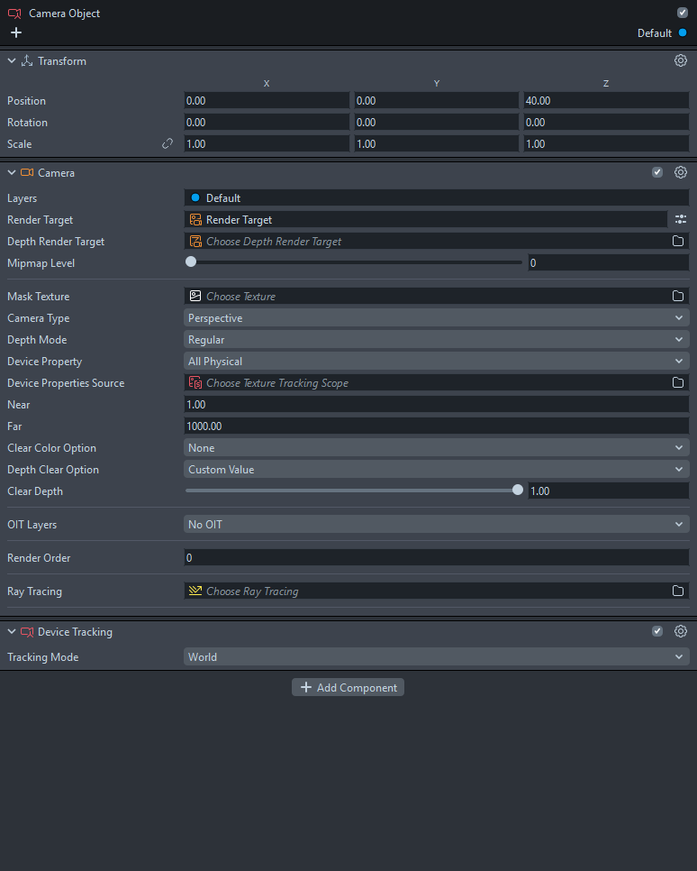
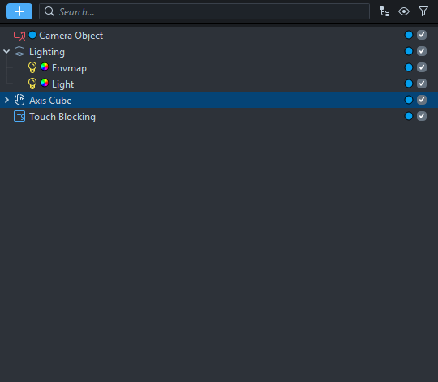
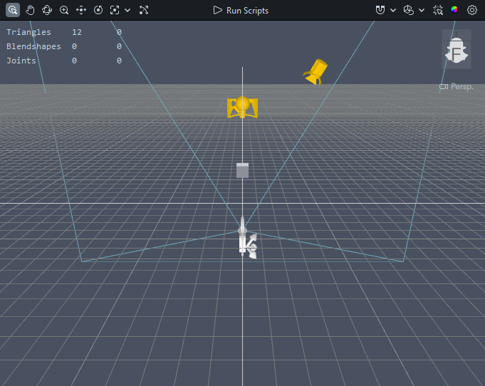
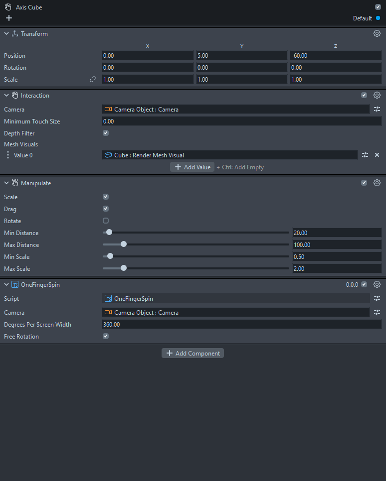
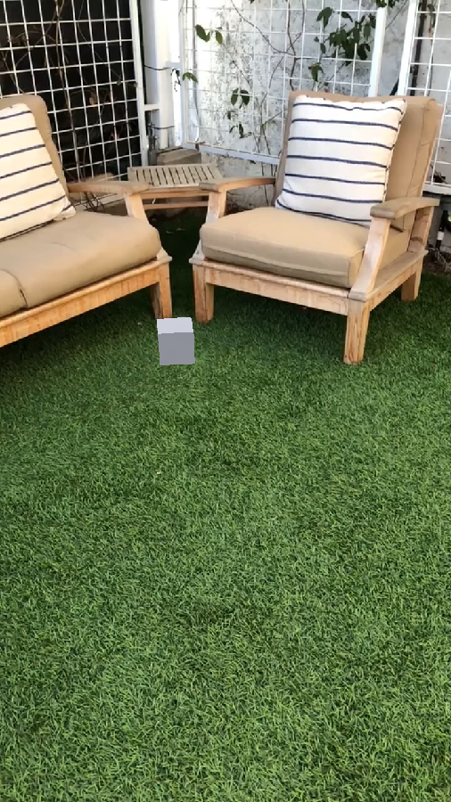

# Lens 1 – 3D Axis Explorer

**What you will build:** A world lens that places a cube in the room. Drag it to move it, pinch to scale it and swipe with one finger to spin it.
**XR concept:** World tracking, 3D coordinates and transforms (Deck 1 spatial concepts)
**Course day:** Day 1
**Lens Studio version:** 5.25 (Windows and macOS)
**Time:** about 15 minutes

> **Status: draft.** The steps match the finished project in [`project/`](project/). They still need a check on a phone.

## What participants learn

- Every object in a 3D scene has a **position, rotation and scale**, measured along three axes.
- **X is left and right, Y is up and down, Z is towards you and away from you.** Y is the height above the ground, not Z.
- In Lens Studio, **1 unit is 1 centimetre**. A cube of scale 10 is 10 cm across.
- **World tracking** keeps a virtual object fixed in the real room while you move your phone around it.

## Assets you need

From `lens-studio/assets/scripts/`:

- `OneFingerSpin.ts` – spins an object when you swipe one finger across the screen.
- `TouchBlocking.ts` – stops Snapchat from taking over your swipes.

Both work in any lens. Nothing else needs to be imported.

## Steps

### Step 1 – Open the starter project

1. Open Lens Studio 5.25.
2. Choose **File → Open Project** and open `lens-studio/001-3d-axis-explorer/project/001-3d-axis-explorer.esproj`.

You should see the Scene Hierarchy (left), the Scene view (centre), the Preview (right), the Inspector and the Asset Browser. The scene starts with a Camera Object and some lighting.

### Step 2 – Turn on world tracking

1. In the **Scene Hierarchy**, select **Camera Object**.
2. In the **Inspector**, click **Add Component** and choose **Device Tracking**.
3. Set **Tracking Mode** to **World**.
4. In the **Preview** panel, switch the camera to the rear camera and pick one of the sample room videos, so you can see the cube sitting in a real space.

Why: Device Tracking uses the phone's camera and motion sensors to understand the room. In **World** mode the origin (0, 0, 0) stays fixed in the room and the camera moves through the scene as the phone moves.

### Step 3 – Add the cube

1. In the **Scene Hierarchy**, click **+** and add an **Empty Scene Object**. Name it `Axis Cube`.
2. Click **+** again and add a **Box** (under Mesh). Name it `Cube`.
3. Drag `Cube` onto `Axis Cube` so that it becomes its child.
4. Select `Cube`. Check that its **Scale** is `10, 10, 10`. That makes it 10 cm across.

Why two objects? Dragging and pinching change the scale of the object that has the gesture components. Keeping those on a parent whose scale is 1 means the scale limits in Step 5 are easy to read: 0.5 is half size and 2 is double size.

### Step 4 – Place it in front of the user

1. Select `Axis Cube`.
2. In the Inspector, set **Position** to `0, 5, -60`.

That means 0 cm to the side, 5 cm up and 60 cm away from the user. Negative Z is away from the camera. The cube is 10 cm tall, so a height of 5 puts its bottom on the floor. Ask participants to change one number at a time and watch which direction the cube moves.

### Step 5 – Let the user move and scale it

1. With `Axis Cube` selected, click **Add Component** and choose **Manipulate**. Lens Studio also adds an **Interaction** component, which Manipulate needs.
2. In the **Interaction** component:
   - Set **Camera** to `Camera Object : Camera`.
   - Under **Mesh Visuals**, click **Add Value** and choose `Cube : Render Mesh Visual`. This tells Lens Studio which object the finger has to touch.
3. In the **Manipulate** component, set:
   - **Drag** on (drag with one finger to move it)
   - **Scale** on (pinch to make it bigger or smaller)
   - **Rotate** off (we use the one-finger spin in Step 6 instead)
   - **Min Distance** `20` and **Max Distance** `100` (so it can't be dragged right up to the camera or far away)
   - **Min Scale** `0.5` and **Max Scale** `2`

### Step 6 – Spin it with one finger

1. Drag `OneFingerSpin.ts` from `lens-studio/assets/scripts/` into the **Asset Browser**.
2. With `Axis Cube` selected, click **Add Component** and choose **Script**. Set its **Script** to `OneFingerSpin`.
3. Set **Camera** to `Camera Object : Camera`.
4. Leave **Degrees Per Screen Width** at `360` and **Free Rotation** on.

Swiping across the cube now rolls it as if the cube were a ball under your finger. Drag **Free Rotation** off to spin it left and right only, like a turntable.

### Step 7 – Stop Snapchat taking your swipes

Without this step, swiping left or right opens Chat or Stories instead of turning the cube.

1. Drag `TouchBlocking.ts` from `lens-studio/assets/scripts/` into the **Asset Browser**.
2. In the Scene Hierarchy, add an **Empty Scene Object** and name it `Touch Blocking`.
3. Add a **Script** component to it and set the script to `TouchBlocking`.

### Step 8 – Try it in the Preview

1. In the Preview, click and drag on the cube to move it.
2. Use the Preview's gesture controls to scale it and to swipe across it.
3. Watch the **Position**, **Rotation** and **Scale** values in the Inspector while you do it. This is the key moment of the exercise: every gesture is just a change to those nine numbers.

## Test on your phone

1. In Lens Studio, click **Pair** (top right) and scan the Snapcode with Snapchat, logged in with the same account.
2. Click **Send to Snapchat**.
3. Point the phone at the floor, then walk around the cube. It should stay where you put it.
4. Drag it, pinch it and swipe across it with one finger.

## Make it your own

- Change the cube's colour, or swap the Box for a Sphere.
- Add a 3D Text label above the cube.
- Add a second cube and make it a child of the first. Move the parent and watch the child follow (local vs world coordinates).
- Show the cube's live position on screen with a Screen Text and a small script.

## Troubleshooting

| Problem | Fix |
|---------|-----|
| The cube moves with the phone | It is inside the Camera Object. Drag it out to the top level of the Scene Hierarchy. |
| Swiping opens Chat or Stories | Add the `Touch Blocking` object from Step 7. |
| Dragging or swiping does nothing | Check the Interaction component lists `Cube : Render Mesh Visual` under Mesh Visuals (Step 5). |
| The cube turns the wrong way or jumps | Check the `OneFingerSpin` Camera is set to `Camera Object : Camera`. |
| The cube is too small or too big | Check `Cube` has Scale `10, 10, 10` and `Axis Cube` has Scale `1, 1, 1`. |
| The cube floats or sinks | Change Position Y on `Axis Cube`. Y is height above the floor in centimetres. |
