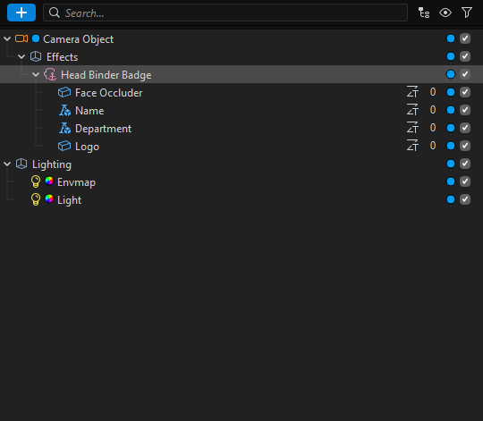
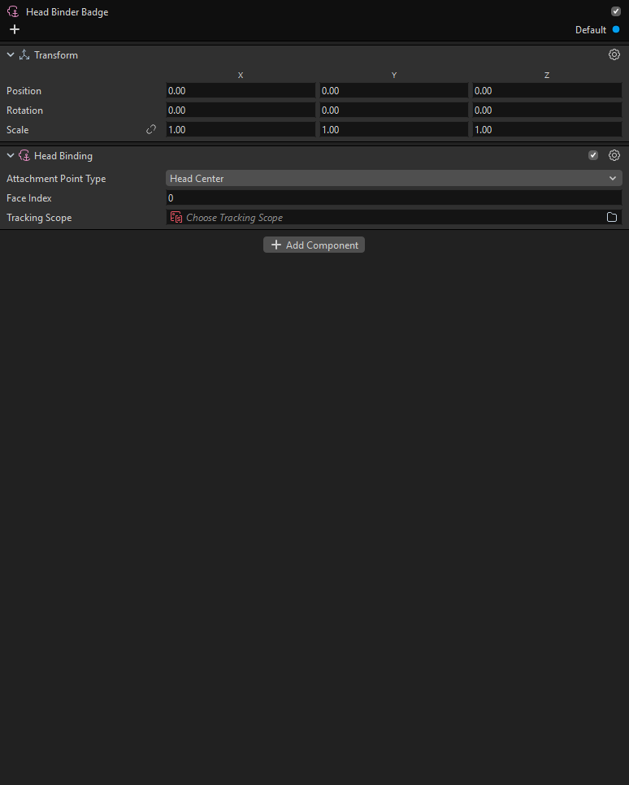
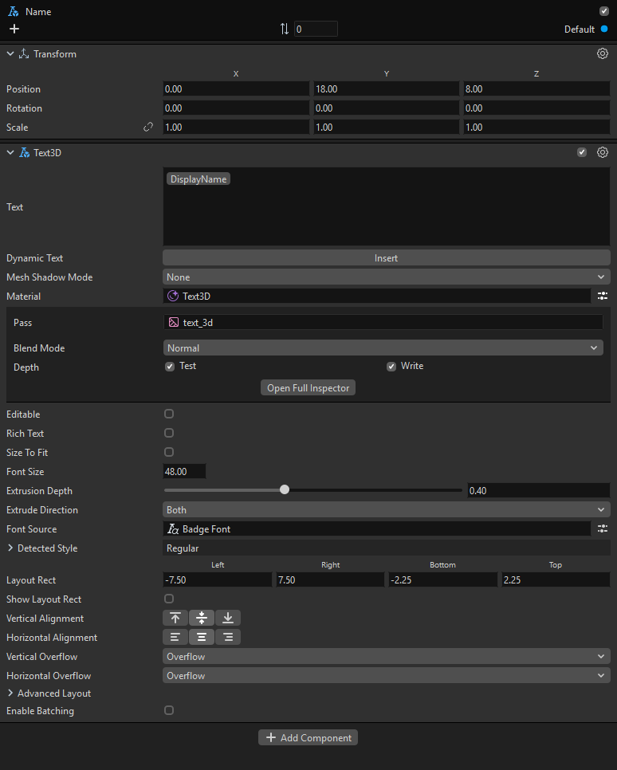
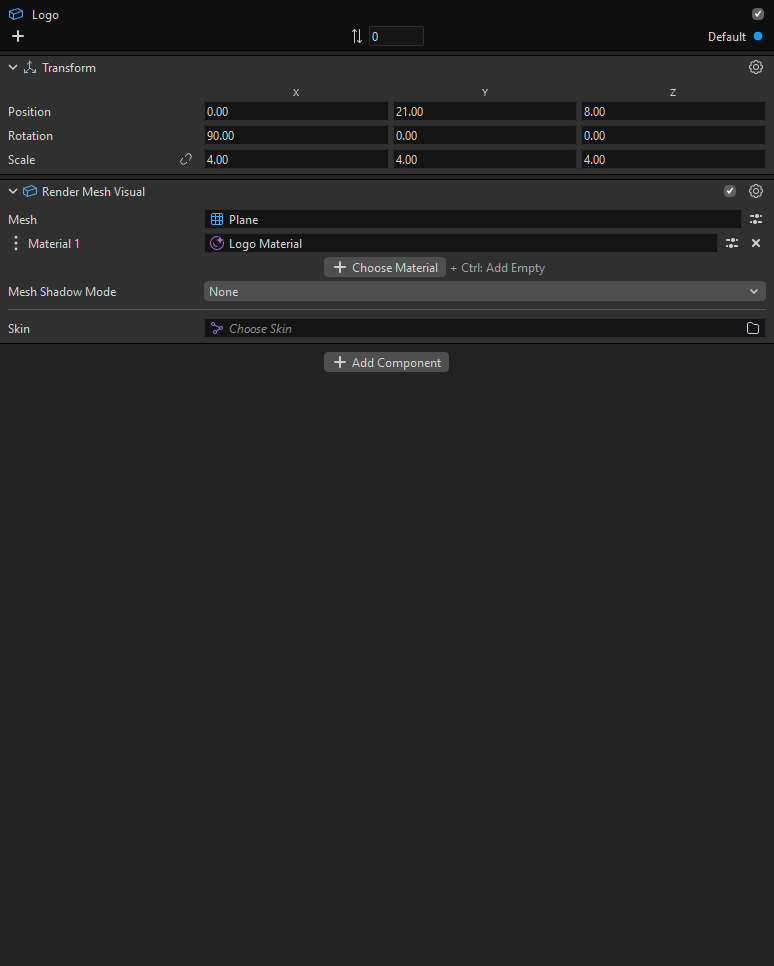

# Lens 2 – Face-Filter Name Badge

**What you will build:** A face lens that floats a name badge above the user's head. It shows the XR department logo, the user's Snapchat display name and the name of a department. The badge follows the head as it moves and turns.
**XR concept:** Face tracking
**Course day:** Day 1
**Lens Studio version:** 5.25 (Windows and macOS)
**Time:** about 20 minutes

> **Status: draft.** The numbers match the finished project in [`project/`](project/). The menu names (such as **+ → Face → Head Binding**) still need a check in Lens Studio 5.25, and the lens needs a test on a phone.

## What participants learn

- **Face tracking** finds a face in the camera image and gives Lens Studio a point on the head to attach things to.
- A **Head Binding** makes everything inside it follow the head, so objects stay put on the face as the user moves.
- You build a face effect from simple parts: 3D text and a flat image (a plane).
- A **face occluder** hides the badge when the head turns, so it doesn't look like it floats in front of the face.

## Assets you need

From `lens-studio/assets/textures/`:

- `department-of-xr.png` – the department logo (a blue and purple "XR" on a dark background).

You also need a font. Lens Studio has a few built in, and the project uses one called `Badge Font`.

## Steps

### Step 1 – Open the starter project

1. Open Lens Studio 5.25.
2. Choose **File → Open Project** and open `lens-studio/002-face-filter-name-badge/project/002-face-filter-name-badge.esproj`.

The scene starts with a Camera Object and some lighting.

### Step 2 – Add a head binding

1. In the **Scene Hierarchy**, click **+** and choose **Face → Head Binding**.
2. Rename the new object `Head Binder Badge`.
3. Select it. In the Inspector the **Head Binding** component should have **Attachment Point Type** set to **Head Center** and **Face Index** `0`.

Lens Studio puts the head binding inside the Camera Object, in a group called `Effects`. Leave it there.

Everything you put inside `Head Binder Badge` now follows the user's head.

### Step 3 – Add the occluder

An occluder is an invisible head shape that hides anything behind it.

1. Inside `Head Binder Badge`, add a head mesh and give it the **Occluder** material. Rename it `Face Occluder`.
2. Set its **Position** to `0, 7.33, 8.74` and its **Scale** to `0.83, 0.83, 0.83`, so it fits the head.

Why: without it, the text would still show through the head when the user turns away from the camera.

### Step 4 – Add the name

1. Inside `Head Binder Badge`, click **+** and choose **3D Text**. Rename it `Name`.
2. In the **Text3D** component, delete the default text. Click **Insert** under **Dynamic Text** and pick **Display Name**. The box now shows `DisplayName` as a tag.
3. Set **Font Size** to `48`, and choose a font in **Font Source**.
4. Set **Position** to `0, 18, 8`.

The display name is the Snapchat name of whoever opens the lens, so every user sees their own name.

To show a fixed name instead, type it into the Text box, for example `Dr. John`.

### Step 5 – Add the department

1. Duplicate `Name` (right-click → **Duplicate**) and rename the copy `Department`.
2. Change the text to `Department of XR` and the **Font Size** to `32`.
3. Set **Position** to `0, 17, 8`.

### Step 6 – Add the logo

1. Drag `department-of-xr.png` from `lens-studio/assets/textures/` into the **Asset Browser**.
2. In the **Asset Browser**, click **+** and choose **Material → Unlit**. Rename it `Logo Material`.
3. Select `Logo Material`. Switch on **Base Texture** and choose `department-of-xr` as the texture.
4. Inside `Head Binder Badge`, add a **Plane** from **+ → Mesh**. Rename it `Logo`.
5. Select `Logo`. Set **Position** to `0, 21, 8`, **Rotation** to `90, 0, 0` and **Scale** to `4, 4, 4`.
6. In the **Render Mesh Visual**, set the material to `Logo Material`.

The plane starts out lying flat. A rotation of 90 degrees around X stands it up so it faces the user.

### Step 7 – Name the lens and choose the camera

1. Open **Project Info** and set the lens **Name** to `Face Name Badge`.
2. Choose the **Front** camera as the camera the lens opens on.
3. Set an icon and, when you are ready to publish, a preview video.

## Test on your phone

1. In Lens Studio, click **Pair** (top right) and scan the Snapcode with Snapchat, logged in with the same account.
2. Click **Send to Snapchat**.
3. Look into the front camera. The badge should float above your head, with your own display name.
4. Move and turn your head. The badge follows and disappears behind your head when you turn away.

## Make it your own

- Change the department text, or add a line for the college.
- Swap the logo for your own image.
- Change the font, or make the text a different colour in the text material.
- Move the badge: try the **Forehead** attachment point and bring the badge down to your face.
- Add a second face: duplicate the `Head Binder Badge` and set its **Face Index** to `1`.

## Troubleshooting

| Problem | Fix |
|---------|-----|
| Nothing appears on my face | Check you are using the front camera and that the Head Binding is switched on. |
| The logo is invisible from the front | Check its **Rotation** is `90, 0, 0` (it starts out lying flat). |
| The logo is a plain grey or white square | Check **Base Texture** is switched on in `Logo Material` and the texture is set. |
| The text looks thin or like outlines | Choose a font in **Font Source** for the Text3D. |
| The badge floats too high or too low | Change the Y position of `Name`, `Department` and `Logo`. |
| The name shows `DisplayName` | That is the Snapchat display name tag, and it shows the real name on a phone. In the Preview it shows a sample name. |
