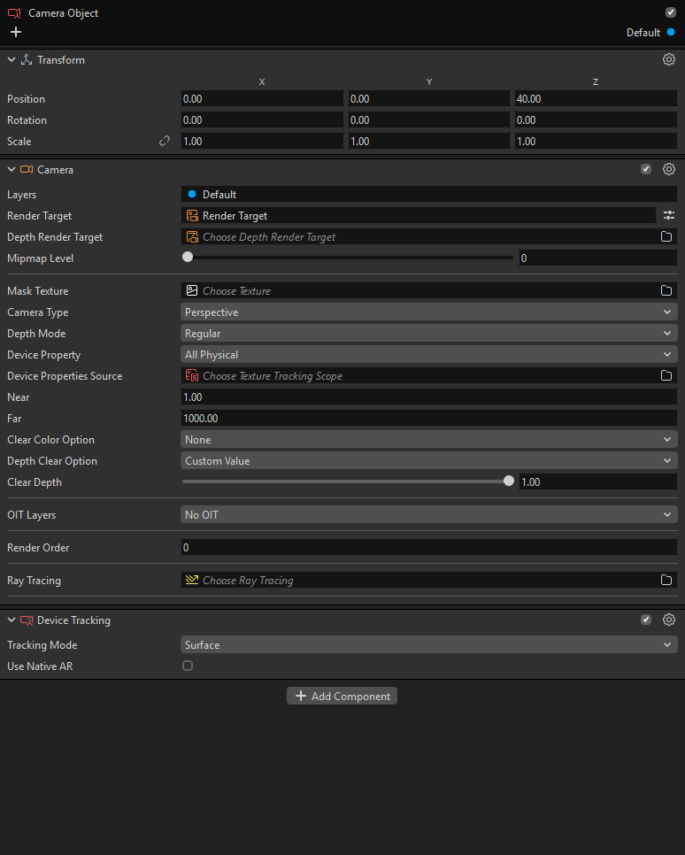
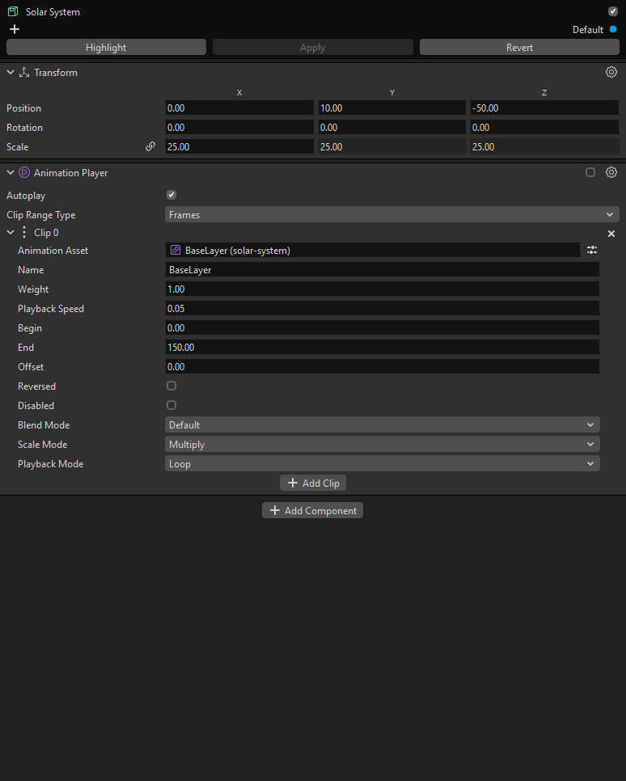
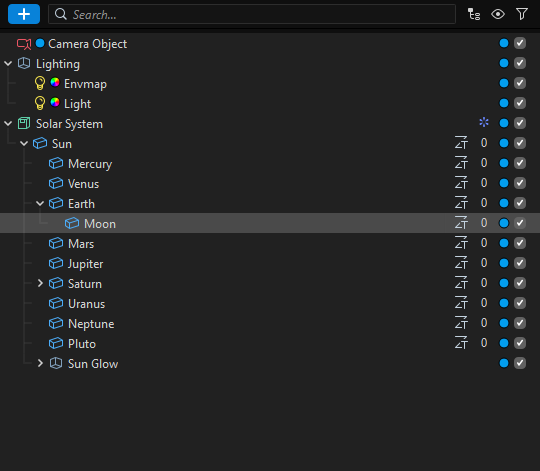
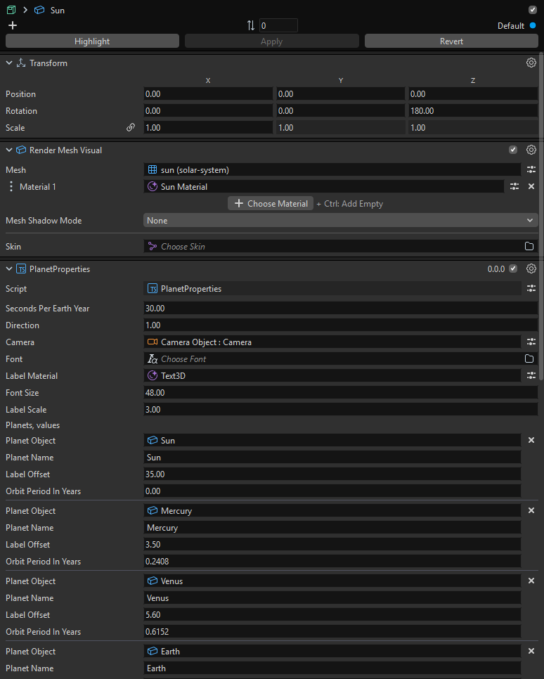
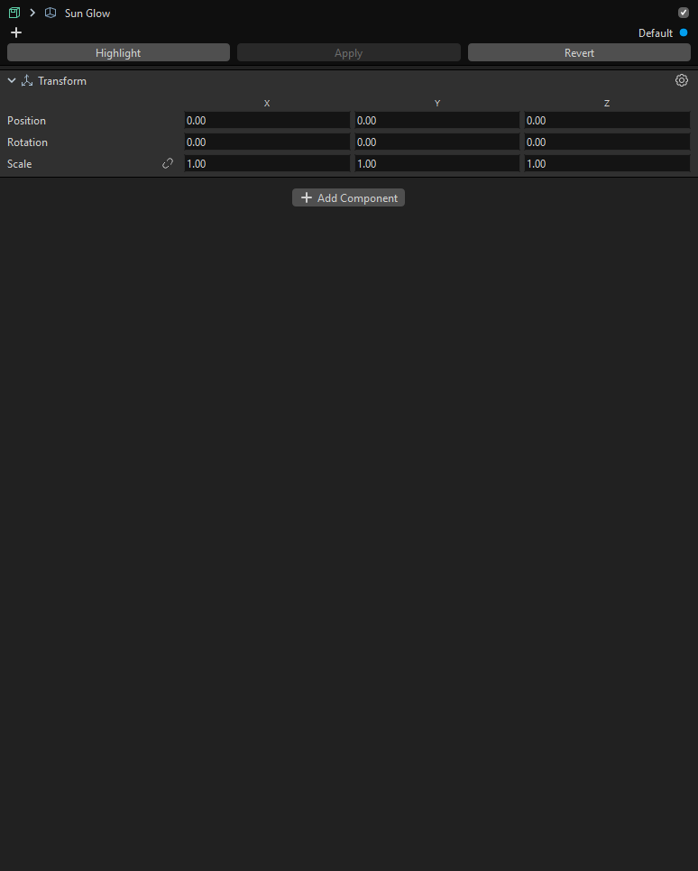
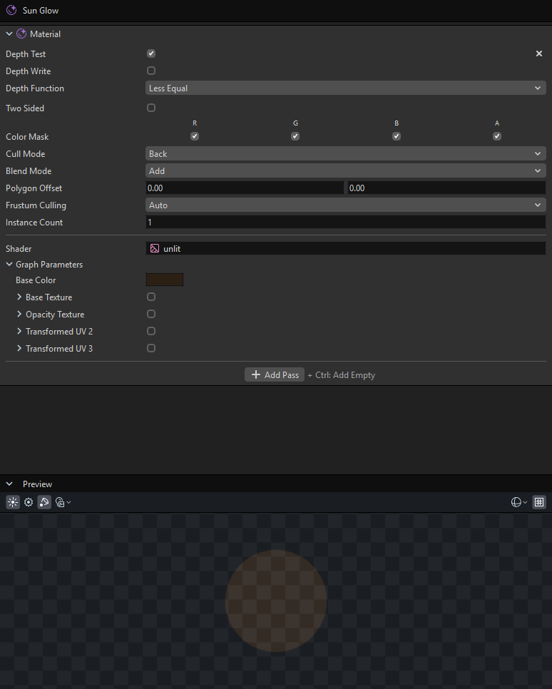
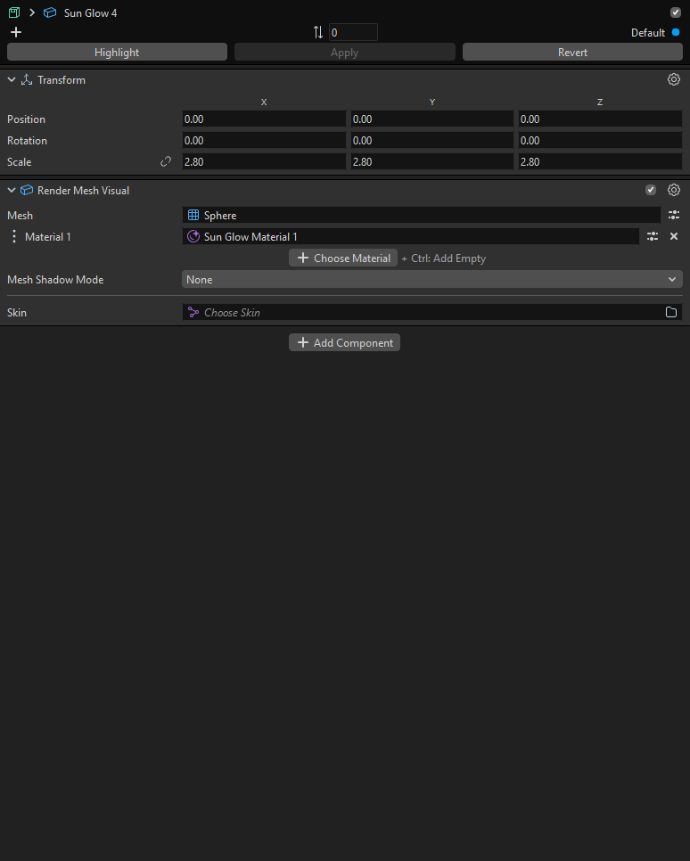

# Lens 3 – Solar System on the Table

**What you will build:** A surface lens that puts the solar system on a table. The planets orbit the Sun at their real speed ratios, and a name floats above each planet.
**XR concept:** Surface tracking, 3D text labels
**Course day:**
**Lens Studio version:** 5.25 (Windows and macOS)
**Time:** about 30 minutes

> **Status: draft.** The numbers match the finished project in [`project/`](project/). The menu names (such as **+ → Screen Text**) still need a check in Lens Studio 5.25, and the lens needs a test on a phone.

## What participants learn

- **Surface tracking** finds a flat surface, such as a table, and keeps virtual objects fixed on it.
- A **parent object** is the centre of its children. Put a planet inside the Sun, move it away from the centre and swing it round the centre, and you have an orbit.
- Real orbits have very different speeds. Mercury goes round the Sun in 88 days and Neptune takes 165 years.
- One script can run every orbit and every label in the scene, from a list with one slot per planet.

## Assets you need

From `lens-studio/assets/models/`:

- `solar-system.fbx` – the Sun, nine planets, Saturn's ring and many moons.

From `lens-studio/assets/scripts/`:

- `PlanetProperties.ts` – makes the planets orbit at real speed ratios and floats a name label above each one.

The planet pictures come with the model, so you don't import them separately.

## Steps

### Step 1 – Open the starter project

1. Open Lens Studio 5.25.
2. Choose **File → Open Project** and open `lens-studio/003-solar-system-on-the-table/project/003-solar-system-on-the-table.esproj`.

### Step 2 – Turn on surface tracking

1. In the **Scene Hierarchy**, select **Camera Object**.
2. In the **Inspector**, click **Add Component** and choose **Device Tracking**.
3. Check **Tracking Mode** is set to **Surface**.

Why: in Surface mode Lens Studio looks for a flat surface in front of the phone and fixes the scene to it, so the solar system stays on the table when you move around.



### Step 3 – Add the solar system

1. Drag `solar-system.fbx` from `lens-studio/assets/models/` into the **Asset Browser**.
2. Drag the imported model from the Asset Browser into the **Scene Hierarchy**, at the top level. Rename it `Solar System`.
3. Select `Solar System`. Set **Position** to `0, 10, -50` and **Scale** to `25, 25, 25`.
4. Select the `sun` inside it and set its **Scale** to `1, 1, 1`.



#### Tidy the layers

The model comes with an empty "pivot" object around every planet, and a lot of moons. Flatten it so that every planet sits straight inside the Sun, and Earth holds its Moon.

1. Rename `sun` to `Sun`.
2. Drag each planet onto the Sun (`mercury_2`, `venus_2`, `earth_2`, `mars_2`, `jupiter_2`, `saturn_2`, `uranus_2`, `neptune_2` and `pluto_2`).
3. Delete the empty pivot objects that are left (`mercury`, `venus`, `earth`, `mars`, `jupiter`, `saturn`, `uranus`, `neptune` and `pluto`).
4. Rename the planets to `Mercury`, `Venus`, `Earth`, `Mars`, `Jupiter`, `Saturn`, `Uranus`, `Neptune` and `Pluto`.

#### Keep only Earth's moon

The model has moons for the other planets too. Delete every moon except Earth's:

1. Delete every object named `moon` followed by a number (for example `moon3`). They are inside the planets.
2. Inside Earth, keep the moon named `moon` and delete `moon5`. Rename it `Moon`.

When you are done the layers look like this. (`saturn_ring` stays inside Saturn, and `Sun Glow` comes in Step 5.)

```
Sun
  Mercury
  Venus
  Earth
    Moon
  Mars
  Jupiter
  Saturn
    saturn_ring
  Uranus
  Neptune
  Pluto
```



#### Turn off the built-in animation

The model has an animation that moves the planets, but its speeds aren't realistic (Pluto goes faster than Mercury). Select `Solar System`, find its **Animation Player** and switch it **off**. You make the orbits yourself in the next step.

### Step 4 – Make the planets orbit and add their names

One script, `PlanetProperties`, does two jobs for every planet: it makes the planet orbit the Sun, and it floats a name label above it. You set a few global settings once, then add one slot for each planet.

#### Get ready

1. Drag `PlanetProperties.ts` from `lens-studio/assets/scripts/` into the **Asset Browser**.
2. Make the label material. Add a **3D Text** to the scene once, so Lens Studio creates a **Text3D** material for it. Select that material, set **Mode** to **Solid** and the colours to white. Then delete the 3D Text object. The material stays in the Asset Browser.

#### Add the script

1. Select the `Sun` object, click **Add Component** and choose **Script**. Set its **Script** to `PlanetProperties`.
2. Fill in the global settings. These apply to every planet:

| Setting | Value | What it does |
|---------|-------|--------------|
| Seconds Per Earth Year | `30` | How long one Earth year lasts in the lens. Smaller is faster. |
| Direction | `1` | `1` turns counter-clockwise seen from above, `-1` clockwise. |
| Camera | `Camera Object : Camera` | The camera the labels turn to face. |
| Font | leave empty | Empty means the default font. |
| Label Material | the white Text3D material | The material for every label. |
| Font Size | `48` | The size of the label text. |
| Label Scale | `3` | The size of every label. Raise it for bigger labels. |

3. Under **Planets**, click **Add Value** once for each planet (eleven times). Each slot has four boxes:

| Box | What it is |
|-----|-----------|
| Planet Object | The planet or moon itself. It orbits the centre of the object it is inside: the Sun for a planet, Earth for the Moon. |
| Planet Name | The words on the label. |
| Label Offset | How high above the planet the label floats, in centimetres. |
| Orbit Period In Years | How long one orbit takes, in Earth years. `0` means it doesn't orbit, like the Sun. |

Fill the slots in with these values:

| Planet Object | Planet Name | Label Offset | Orbit Period In Years | One orbit in the lens |
|---------------|-------------|--------------|-----------------------|-----------------------|
| `Sun` | Sun | 35 | 0 | does not orbit |
| `Mercury` | Mercury | 3.5 | 0.2408 | about 7 seconds |
| `Venus` | Venus | 5.6 | 0.6152 | about 18 seconds |
| `Earth` | Earth | 5.6 | 1 | 30 seconds |
| `Moon` | Moon | 3.1 | 0.0748 | about 2 seconds |
| `Mars` | Mars | 5 | 1.8808 | about 56 seconds |
| `Jupiter` | Jupiter | 8.8 | 11.862 | about 6 minutes |
| `Saturn` | Saturn | 9 | 29.457 | about 15 minutes |
| `Uranus` | Uranus | 7 | 84.02 | about 42 minutes |
| `Neptune` | Neptune | 7 | 164.8 | about 82 minutes |
| `Pluto` | Pluto | 3.4 | 248 | about 2 hours |

The speeds are real: an Earth year lasts 30 seconds in the lens and every other planet is scaled from that. The outer planets move so slowly you will barely see them. That is the point: the solar system is mostly empty space and patience.

Want it faster or slower? Change **Seconds Per Earth Year**.

The labels don't exist in the Scene view. The script makes them when the lens starts, so you only see them when you run it. Each label follows its planet around its orbit and turns to face the camera.



### Step 5 – Make the Sun glow

The model's own Sun material is a plain lit surface that looks dull. Replace it with a bright flat colour and wrap the Sun in soft glowing layers.

#### The Sun's colour

1. In the **Asset Browser**, click **+** and choose **Material → Unlit**. Rename it `Sun Material`.
2. Set its **Base Color** to a bright orange-yellow: `1, 0.8, 0.15`.
3. Select the `Sun` object. In its **Render Mesh Visual**, replace the material with `Sun Material`.

An unlit material ignores the lights, so the Sun is the same bright colour from every side.



#### The Sun Glow material

All the glow layers share one material. It has a single control, its opacity, that sets how strong the glow is for every layer at once.

1. In the **Asset Browser**, click **+** and choose **Material → Unlit**. Rename it `Sun Glow`.
2. Select it and set **Blend Mode** to **Add**, and switch **Depth Write** off.
3. Set **Base Color** to a warm orange: `1, 0.55, 0.1`.
4. Set the **Alpha** of the Base Color to `0.1`. This is the glow's opacity. A higher alpha makes every layer brighter, a lower alpha makes the glow fainter.



The material is **Unlit**, not PBR, on purpose. A PBR material is shaded by the scene's lights, so it would show dark and light sides. An unlit material has no shading, so each layer is an even soft glow.

Add blend mode adds the material's colour, times its opacity, to whatever is behind it. Where the layers stack up the glow is brightest, and it fades towards the edge.

#### The glow layers

A glow is a few larger, see-through spheres around the Sun. They all use the one `Sun Glow` material.

1. Inside the `Sun` object, add an **Empty Scene Object** and name it `Sun Glow`, so the layers stay tidy.
2. Inside it, add a **Sphere** (**+ → Mesh → Sphere**). Rename it `Sun Glow 1`, set its material to `Sun Glow` and set its **Scale** to `2.2, 2.2, 2.2`.
3. Duplicate it seven times, for `Sun Glow 2` to `Sun Glow 8`. They all use the same material. Give them these scales:

| Layer | Scale |
|-------|-------|
| Sun Glow 1 | 2.2 |
| Sun Glow 2 | 2.4 |
| Sun Glow 3 | 2.6 |
| Sun Glow 4 | 2.8 |
| Sun Glow 5 | 3.0 |
| Sun Glow 6 | 3.2 |
| Sun Glow 7 | 3.4 |
| Sun Glow 8 | 3.6 |

The Sun itself is at scale 2 inside this object, so the first glow layer is 10% bigger than the Sun and the last is 80% bigger.

More layers give a smoother fade. Fewer layers show visible steps.



#### Tidy up

Each time you add a sphere, Lens Studio makes a new PBR material for it, called `PBR`, `PBR 2` and so on. You don't use them any more, because every layer uses `Sun Glow`. In the **Asset Browser**, delete the unused PBR materials, and the `Base`, `Normal` and `MaterialParams` pictures and the `pbr` shader that came with them.

### Step 6 – Name the lens and choose the camera

1. Open **Project Info** and set the lens **Name**.
2. Choose the **Rear** camera as the one the lens opens on. A surface lens points at a table, so it uses the rear camera.
3. Set an icon and, when you are ready to publish, a preview video.

## Test on your phone

1. In Lens Studio, click **Pair** (top right) and scan the Snapcode with Snapchat, logged in with the same account.
2. Click **Send to Snapchat**.
3. Point the rear camera at a table and move the phone slowly until the solar system appears.
4. Watch Mercury and Venus go round and look for the name above each planet.

## Make it your own

- Add a moon: put it inside a planet, move it away from the planet's centre, then add a slot for it to the `Planets` list with its name and orbit time.
- Make one planet orbit the other way. Use a second `PlanetProperties` with **Direction** set to `-1`.
- Put a second line in a label's **Label Name**, such as how long its year is.
- Change **Seconds Per Earth Year** to see the solar system run faster.
- Change the Sun's colour, add more glow layers for a softer fade, or change the **Alpha** of `Sun Glow` to make the whole glow brighter or fainter.
- Make the planets bigger than they are in real life, so they are easier to see.

## Troubleshooting

| Problem | Fix |
|---------|-----|
| The solar system doesn't appear | Move the phone slowly over a flat, well-lit surface. Check **Tracking Mode** is **Surface**. |
| The planets don't move | Check each planet's slot in `PlanetProperties` has an **Orbit Period In Years** above 0, and that the **Animation Player** is switched off. |
| Pluto moves faster than Mercury | The **Animation Player** is still on. Switch it off. |
| A label is missing | Check its slot has a **Planet Object** and a **Planet Name**. |
| The labels are in the wrong place | Check each slot's **Planet Object** and **Label Offset**, and that **Camera** is set. |
| The labels are too small or too big | Change **Label Scale** on `PlanetProperties`. |
| The label text looks thin or like outlines | Set **Label Material** on `PlanetProperties`. If it still looks thin, choose a font in **Font**. |
| A planet goes round the wrong point | The planet must sit directly inside the Sun, and the Sun's own position is the centre of the orbit. |
| The planets are too small | Raise the **Scale** of `Solar System`. |
| The Sun looks yellow-green and washed out | The glow layers add up on top of the Sun. Lower the Sun's **Base Color** a little, or lower the **Alpha** of `Sun Glow`. |
| The glow shows hard steps | Add more glow layers, with smaller steps in their scales. |

## Credits

The "Solar System" 3D model and its planet textures are by NANDA KUMAR ([@Nandakumar000](https://sketchfab.com/Nandakumar000)) on Sketchfab, used under the [Creative Commons Attribution 4.0](http://creativecommons.org/licenses/by/4.0/) licence. [View the original model](https://sketchfab.com/3d-models/solar-system-b6b69a95a6f0426bb8bbc2e8cb7ff46a).
