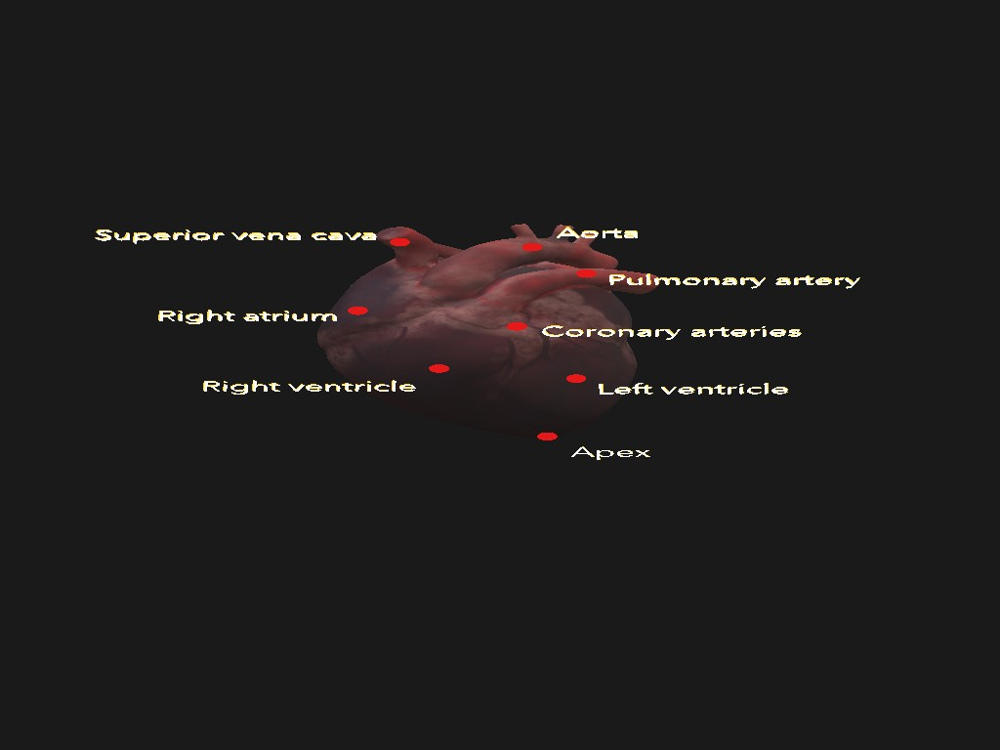
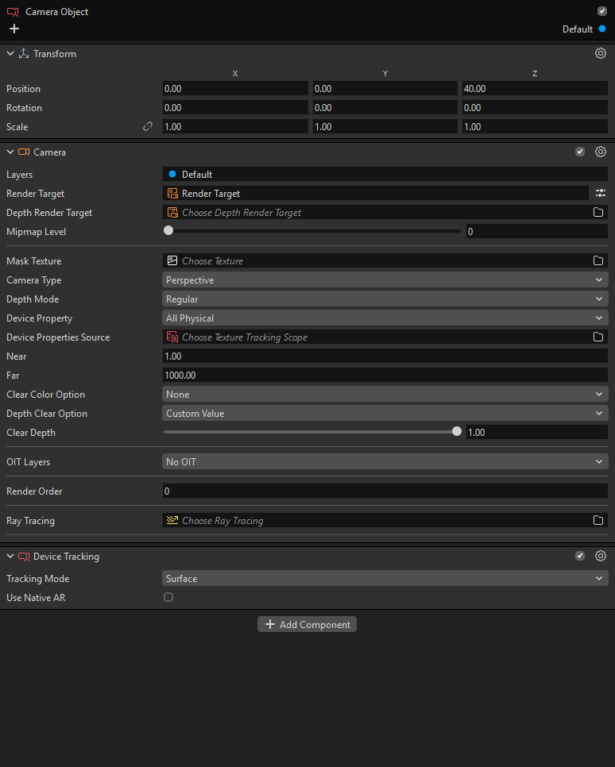
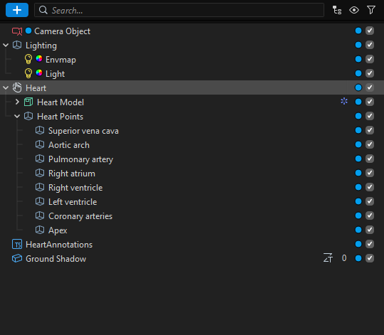
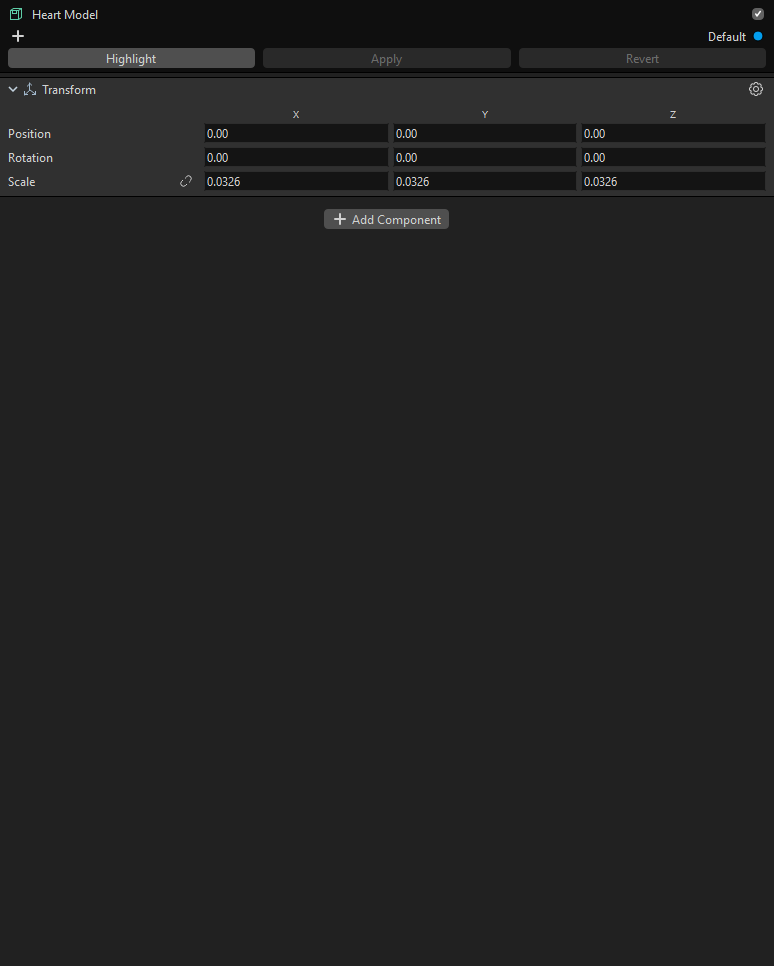
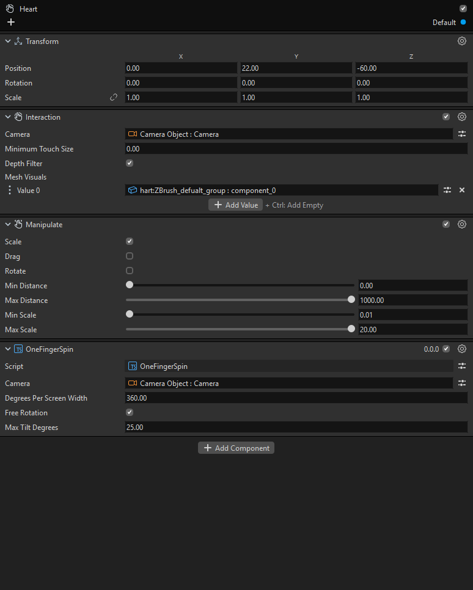
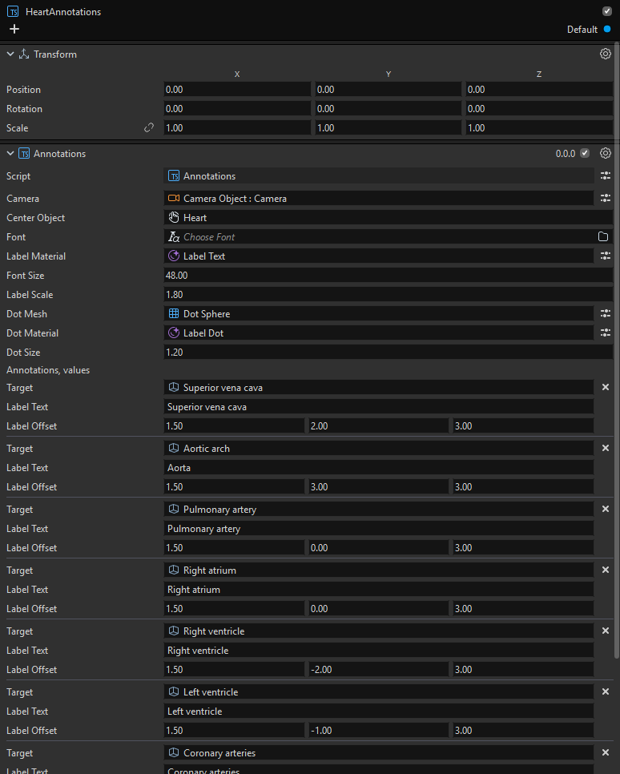

# Lens 4 – Anatomy Overlay: The Human Heart

**What you will build:** A surface lens that places a large 3D human heart on the floor or a table. Spin it with one finger, and read the name of each part on labels with dots that point at the parts.
**XR concept:** Surface tracking, 3D anatomy models and annotation labels
**Course day:**
**Lens Studio version:** 5.25 (Windows and macOS)
**Time:** about 30 minutes

> **Status: draft.** The numbers match the finished project in [`project/`](project/). The label positions were placed by eye, and the surface tracking and shadow still need a check on a phone. The menu names (such as **+ → Mesh → Sphere**) need a check in Lens Studio 5.25.

## What participants learn

- **Surface tracking** finds a flat surface, such as a floor or a table, and keeps a 3D model fixed on it while you move your phone around it.
- A **shadow** under an object makes it look as if it is really sitting in the room.
- Real 3D models come in their own size. Models from the internet are often far too big or too small, so you scale them to suit the lens.
- An **annotation** is a label that points at one part of a model. One small script can make a label and a dot for every part, and keep them facing the camera as the model spins.
- The parts of the heart and what each one does.

## Assets you need

From `lens-studio/assets/models/`:

- `heart.fbx` – a detailed human heart (22,000 triangles) with its picture textures inside.

From `lens-studio/assets/scripts/`:

- `OneFingerSpin.ts` – spins an object when you swipe one finger across it.
- `Annotations.ts` – floating labels with dots, from one list.

## Steps

### Step 1 – Open the starter project

1. Open Lens Studio 5.25.
2. Choose **File → Open Project** and open `lens-studio/004-anatomy-overlay/project/004-anatomy-overlay.esproj`.

### Step 2 – Turn on surface tracking

1. In the **Scene Hierarchy**, select **Camera Object**.
2. In the **Inspector**, click **Add Component** and choose **Device Tracking**.
3. Check **Tracking Mode** is set to **Surface**.

Why: in Surface mode Lens Studio looks for a flat surface in front of the phone, such as a floor or a table, and fixes the scene to it. The heart stays on that surface as you walk around it, instead of floating in front of the screen.

### Step 3 – Add the heart

1. Drag `heart.fbx` from `lens-studio/assets/models/` into the **Asset Browser**.
2. Drag the imported model from the Asset Browser into the **Scene Hierarchy**, at the top level. Rename it `Heart Model`.
3. Add an **Empty Scene Object** at the top level and name it `Heart`. Set its **Position** to `0, 30, -70` and its **Scale** to `1.5, 1.5, 1.5`.
4. Drag `Heart Model` onto `Heart`, so that the model is inside it.
5. Select `Heart Model` and set its **Scale** to `0.0326, 0.0326, 0.0326`.

Why two objects? The model is about 920 cm tall when it arrives, because it was made in a different unit. A scale of 0.0326 shrinks it to about 30 cm. `Heart` then enlarges it by 1.5 to about 45 cm, a good size to see and read. `Heart` is also the parent that moves and spins, so the model and the points you add later turn and grow together. To make the heart bigger or smaller, change the scale of `Heart`, not of `Heart Model`.

The position puts the heart 70 cm in front of you and 30 cm above the surface. The heart is 45 cm tall, so its bottom floats about 7 cm above the surface, and the shadow you add next makes it look as if it is hovering over the floor.

#### Show the surface detail

The heart comes with a **normal map**, a picture that fakes small bumps and grooves, such as the folds of the muscle and the lines of the vessels, without adding triangles. Lens Studio doesn't switch it on by itself.

1. In the **Asset Browser**, select the material called `Heart Tex`.
2. Switch **Normal Map** on and set its **Texture** to the picture whose name ends in `Normal` (it is inside the heart model).

The light now catches the surface, and the heart looks less flat.

#### Ground it with a shadow

A shadow tells the eye that the heart is over a real surface.

1. In the **Scene Hierarchy**, click **+** and choose **Mesh → Shadow Plane**. Rename it `Ground Shadow`. Set its **Position** to `0, 0, -70` and its **Scale** to `60, 60, 60`. It has a **Matte Shadow** material, which shows only the shadow and is invisible otherwise.
2. Select the **Light**. In the Inspector switch **Casts Shadows** on and set **Shadow Type** to **Shadow Map**.
3. Select the heart's mesh (inside `Heart Model`) and set its **Mesh Shadow Mode** to **Caster**.

### Step 4 – Spin it with one finger

1. Drag `OneFingerSpin.ts` from `lens-studio/assets/scripts/` into the **Asset Browser**.
2. Select `Heart`. Click **Add Component** and choose **Interaction**.
3. In the **Interaction**, set **Camera** to `Camera Object : Camera`. Under **Mesh Visuals**, click **Add Value** and choose the heart's **Render Mesh Visual** (it is inside `Heart Model`). This tells Lens Studio which object a finger can touch.
4. Click **Add Component** and choose **Script**. Set its **Script** to `OneFingerSpin`, and its **Camera** to `Camera Object : Camera`.
5. Set **Max Tilt Degrees** to `25`.

Swiping across the heart now spins it. Left and right turns are free, but the heart can only tip up or down 25 degrees from upright, so it can't flip over. Leave **Max Tilt Degrees** at `180` for no limit.

Note: on a phone, Snapchat may react to a swipe left or right by opening Chat or Stories. If that gets in the way, use the `TouchBlocking.ts` script from `lens-studio/assets/scripts/` (see lens 1). It tells Snapchat to leave swipes to the lens.

### Step 5 – Add the labels

The labels are made by one script, `Annotations`. For each part of the heart you give it a point to aim at, the words, and where the label floats. The script makes a text label and a red dot, keeps the dot on the point, and turns the label to face you.

#### The points

1. Inside `Heart`, add an **Empty Scene Object** and name it `Heart Points`.
2. Inside `Heart Points`, add one **Empty Scene Object** for each part and give it a **Position**:

| Point | Position |
|-------|----------|
| Superior vena cava | `-5.9, 12.6, 9` |
| Aortic arch | `1.9, 11.9, 9` |
| Pulmonary artery | `5.1, 8.2, 9` |
| Right atrium | `-8.4, 3, 9` |
| Right ventricle | `-3.6, -5.1, 9` |
| Left ventricle | `4.5, -6.5, 9` |
| Coronary arteries | `1, 0.8, 9` |
| Apex | `2.8, -14.6, 9` |

The points are inside `Heart`, so they turn with the heart. The last number, 9, puts each point just in front of the heart's surface so the dot is not hidden inside it.

#### The dot and the text

1. In the **Asset Browser**, click **+** and choose **Mesh → Sphere**. Rename it `Dot Sphere`.
2. Click **+** and choose **Material → Unlit**. Rename it `Label Dot` and set its **Base Color** to red.
3. Add a **3D Text** to the scene once, so that Lens Studio makes a **Text3D** material. Select that material, set **Mode** to **Solid**, and set the colours to white. Rename it `Label Text`. Then delete the 3D Text object. The material stays in the Asset Browser.

#### The script

1. Drag `Annotations.ts` from `lens-studio/assets/scripts/` into the **Asset Browser**.
2. Add an **Empty Scene Object** at the top level and name it `HeartAnnotations`. Add a **Script** component and set its **Script** to `Annotations`.
3. Set the settings:

| Setting | Value | What it does |
|---------|-------|--------------|
| Camera | `Camera Object : Camera` | The camera the labels turn to face. |
| Center Object | `Heart` | The centre of the heart. Labels go left or right of it, away from the centre. |
| Label Material | `Label Text` | The white text. |
| Font Size | `48` | The size of the text. |
| Label Scale | `3` | The size of every label. Raise it for bigger labels. |
| Dot Mesh | `Dot Sphere` | The shape of the dots. |
| Dot Material | `Label Dot` | The colour of the dots. |
| Dot Size | `1.2` | The size of the dots, in centimetres. |

4. Under **Annotations**, click **Add Value** once for each part. Each slot has three boxes: **Target** (the point), **Label Text** (the words) and **Label Offset** (where the label floats):

| Target | Label Text | Label Offset |
|--------|------------|--------------|
| Superior vena cava | Superior vena cava | `1.5, 2, 3` |
| Aortic arch | Aorta | `1.5, 3, 3` |
| Pulmonary artery | Pulmonary artery | `1.5, 0, 3` |
| Right atrium | Right atrium | `1.5, 0, 3` |
| Right ventricle | Right ventricle | `1.5, -2, 3` |
| Left ventricle | Left ventricle | `1.5, -1, 3` |
| Coronary arteries | Coronary arteries | `1.5, 0, 3` |
| Apex | Apex | `1.5, -2, 3` |

The three numbers of **Label Offset** are in centimetres: **X** is the gap between the dot and the nearest edge of the text (the script works out left or right for each label, and keeps the same small gap whatever the length of the words), **Y** is up and **Z** is towards you.

The labels don't exist in the Scene view. The script makes them when the lens starts.

### Step 6 – Name the lens and choose the camera

1. Open **Project Info** and set the lens **Name**.
2. Choose the **Rear** camera as the one the lens opens on. This lens points at a floor or a table, so it uses the rear camera.
3. Set an icon and, when you are ready to publish, a preview video.

## Test on your phone

1. In Lens Studio, click **Pair** (top right) and scan the Snapcode with Snapchat, logged in with the same account.
2. Click **Send to Snapchat**.
3. Point the rear camera at the floor or a table and move the phone slowly until the heart appears.
4. Swipe across the heart with one finger to spin it. Read the labels.

## What each part does

| Part | What it does |
|------|--------------|
| Superior vena cava | Brings blood with little oxygen from the head and arms back to the heart. |
| Right atrium | Receives that blood and passes it to the right ventricle. |
| Right ventricle | Pumps the blood to the lungs through the pulmonary artery. |
| Pulmonary artery | Carries blood to the lungs, where it picks up oxygen. |
| Left ventricle | The strongest chamber. It pumps oxygen-rich blood out to the body. |
| Aorta | The largest artery. It carries blood from the left ventricle to the body. |
| Coronary arteries | Feed the heart muscle itself with blood. |
| Apex | The pointed tip of the heart, formed by the left ventricle. |

## Make it your own

- Add more parts, such as the left atrium, the pulmonary veins, or the valves. Add a point for each, then a slot in the `Annotations` list.
- Make the labels bigger or smaller with **Label Scale**.
- Change the dot colour in the `Label Dot` material.
- Add a second `Annotations` script with its own points, switched on by another object.
- Make the heart beat: scale `Heart Model` up and down a little with a script.

## Troubleshooting

| Problem | Fix |
|---------|-----|
| The heart doesn't appear | Check **Tracking Mode** is **Surface**. Move the phone slowly over a flat, well-lit surface. |
| The heart is huge or tiny | Check `Heart Model` has Scale `0.0326, 0.0326, 0.0326` and `Heart` has Scale `1.5, 1.5, 1.5`. |
| Spinning does nothing | Check the **Interaction** on `Heart` lists the heart's **Render Mesh Visual** under **Mesh Visuals**. |
| A swipe opens Chat or Stories | Add the `TouchBlocking.ts` script from the shared scripts folder to an empty object. |
| There is no shadow | Check the **Light** has **Casts Shadows** switched on, the heart's mesh is a **Caster**, and `Ground Shadow` is directly below the heart. |
| A label is missing | Check its slot in `Annotations` has a **Target** and a **Label Text**. |
| A dot floats away from the heart | Move that point inside `Heart Points`. Dots follow their point. |
| A dot is hidden inside the heart | Raise the last number (Z) of the point's position. |
| The labels are too small | Raise **Label Scale** on `Annotations`. |
| The text looks thin | Set **Label Material** on `Annotations`. If it still looks thin, choose a font in **Font**. |

## Credits

The "Realistic Human Heart" 3D model and its textures are by neshallads ([profile](https://sketchfab.com/neshallads)) on Sketchfab, used under the [Creative Commons Attribution 4.0](http://creativecommons.org/licenses/by/4.0/) licence. [View the original model](https://sketchfab.com/3d-models/realistic-human-heart-3f8072336ce94d18b3d0d055a1ece089).
