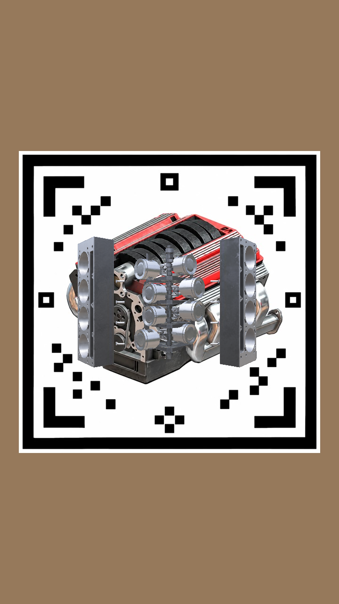
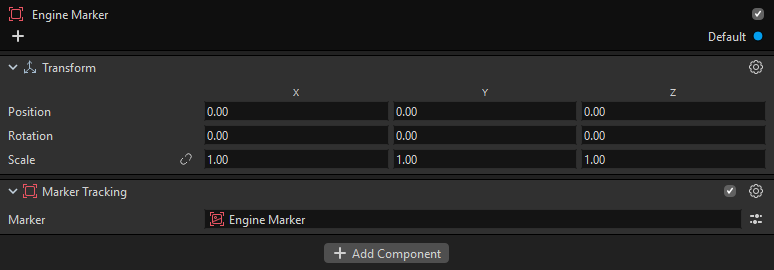
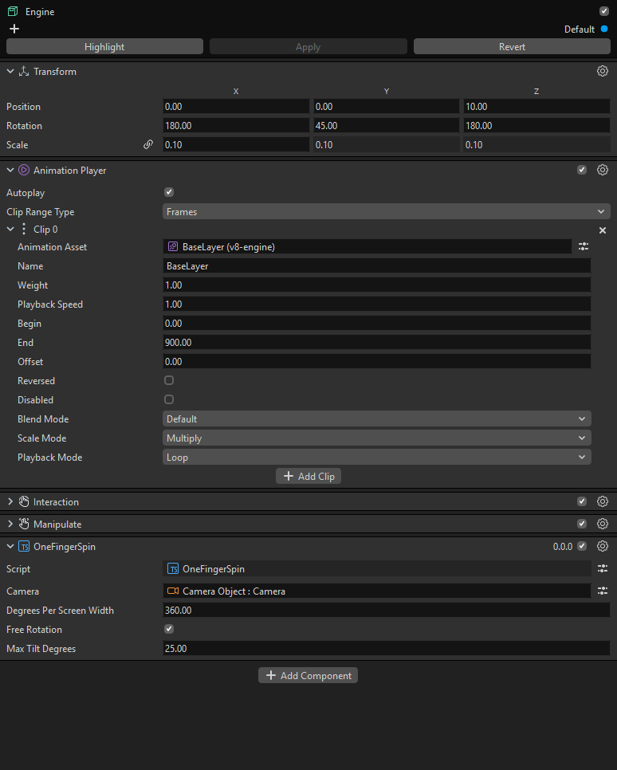
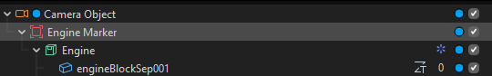

# Lens 5 – Marker-Based Textbook

**What you will build:** Point your phone at a printed textbook page and an animated 3D V8 engine pops up off the page, flying apart and back together so you can see every part.
**XR concept:** Image marker tracking
**Lens Studio version:** 5.25 (Windows and macOS)
**Time:** about 25 minutes

## Assets you need

From `lens-studio/assets/`:
- `textures/engine-marker.png` (the printed page, also used as the marker)
- `models/v8-engine.fbx` (the animated engine)
- `textures/v8-engine/` (the engine's pictures: colour, normal, and the packed `engine-orm.png`)

## How marker tracking works

Lens Studio looks through the camera for a picture it already knows. This picture is the **marker**. When it finds it, it moves everything inside a **Marker Tracking** object to sit on that picture, and keeps it there as you move the phone.

A good marker has lots of fine, high-contrast detail all over it. Plain areas give the tracker nothing to hold on to. That is why the page has a thick frame, corner brackets and little pixel patterns around the engine.

## Steps

### Step 1 – Create a new project

1. Open Lens Studio and choose **File > New Project**, or copy the `_lens-template` folder and open it.
2. Save it as `005-marker-based-textbook`.

### Step 2 – Add the marker

1. In the **Asset Browser**, drag `engine-marker.png` into the panel. It imports as a picture.
2. Right-click in the Asset Browser and choose **Add New > Image Marker**. Name it `Engine Marker`.
3. Select `Engine Marker` and set its **Texture** to `engine-marker`. Its **Height** is the real size of the printed page in centimetres. Leave it at 21 for an A5 or a screen-sized square.
4. In the **Scene Hierarchy**, click **+** and add an **Image Marker** object (it appears inside Camera Object). Rename it `Engine Marker`.
5. Select it and set **Marker** to the `Engine Marker` asset.

### Step 3 – Add the engine

1. Drag `v8-engine.fbx` into the Asset Browser. Lens Studio imports the model, its pieces and its animation.
2. Drag the new `v8-engine` object from the Asset Browser onto `Engine Marker` in the Scene Hierarchy, so the engine sits **inside** it. Rename it `Engine`.
3. Select `Engine` and set these:

| Setting | Value | Why |
|---------|-------|-----|
| Position | 0, 0, 10 | On the page, lifted 10 cm so it floats above it |
| Rotation | 180, 45, 180 | Turns the engine so it sits upright and shows its front corner |
| Scale | 0.1, 0.1, 0.1 | Small enough to sit on the page |

The engine came with an **Animation Player** with **Autoplay** on, **End** set to 900 frames and **Loop** as its playback mode. The pieces fly apart, then back together, again and again. That is the exploded view you see in textbooks.

### Step 4 – Spin and resize it

Let people turn the engine and zoom in on a part with their fingers.

1. With `Engine` selected, click **Add Component > Interaction**, then **Add Component > Manipulate**. In Manipulate, switch **Rotate** and **Scale** on and leave **Drag** off, so the engine stays on the page.
2. Drag `OneFingerSpin.ts` from `lens-studio/assets/scripts/` into the Asset Browser, then add it to `Engine` as a **Script** component.
3. Set its **Camera** to `Camera Object`, and **Max Tilt Degrees** to 25 so the engine can't flip upside down. Turning left and right stays free.

One finger now spins the engine. Two fingers pinch it bigger or smaller and twist it.

### Step 5 – Give the engine its metal

The model arrives plain white. Give it a material that uses its pictures:

1. Add a new **PBR** material and name it `Engine Metal`.
2. Set **Base Texture** to `initialShadingGroup_albedo`, **Normal Texture** to `initialShadingGroup_normal` and **Material Params Texture** to `engine-orm`.
3. Select all the engine's parts and set their **Material** to `Engine Metal`. (In the Scene Hierarchy, select `Engine`, then select its mesh children and drag the material onto them.)

`engine-orm` packs three pictures into one: occlusion in the red channel, roughness in green and metalness in blue. It is already made for you.

### Step 6 – Choose the camera

In **Project Info**, set **Camera** to **Rear**, so the phone looks at the page and not at you.

### Step 7 – Test on your phone

1. Print `engine-marker.png`, or open it on a laptop screen.
2. Pair your phone with Lens Studio and send the lens (the **Send to Snapchat** button).
3. Point the rear camera at the page. The engine appears on it within a second.

## What each part does

| Part | What it does |
|------|--------------|
| Engine Marker (asset) | The picture Lens Studio looks for, and its real size |
| Engine Marker (object) | Follows the picture. Everything inside it sticks to the page |
| Engine | The 3D model with its looping animation |
| Engine Metal | The material that gives the engine its metal look |
| Interaction, Manipulate, OneFingerSpin | Let you spin the engine with one finger and pinch or twist it with two |

## Make it your own

- Replace the page: put your own diagram in the middle of the marker, such as a heart or a bridge.
- Replace the model: use any animated model from Sketchfab.
- Change `Playback Speed` on the Animation Player to slow the engine down.
- Change `Max Tilt Degrees` on OneFingerSpin to let the engine tilt further, or 180 for no limit.

## Troubleshooting

| Problem | Fix |
|---------|-----|
| The engine never appears | The tracker can't see enough detail. Make the page bigger or brighter, and avoid glare |
| It appears but jumps around | Hold the phone steadier, and print the page flat |
| The engine is white | Check Step 5, the material may not be on every part |
| It is too big or too small | Change `Scale` on `Engine` |
| It lies flat on the page | Check `Rotation` is 180, 45, 180 |

## Credits

"V8 Engine" by little.bucket on Sketchfab, [CC Attribution-NonCommercial 4.0](http://creativecommons.org/licenses/by-nc/4.0/). [Original model](https://sketchfab.com/3d-models/v8-engine-90c115119767433fbf6f33dda1302893). For non-commercial use only.
