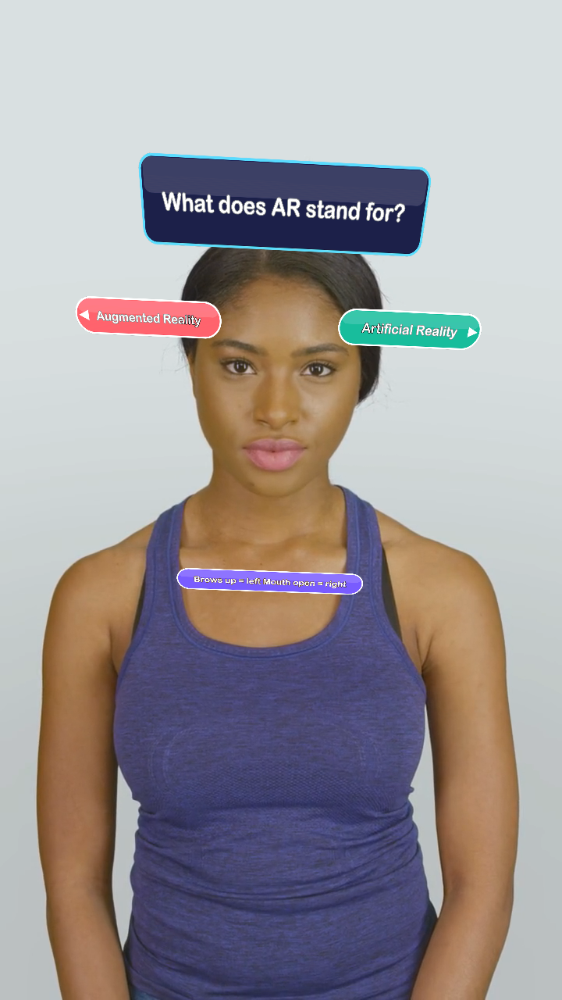

# Lens 6 – AR Quiz Lens

**What you will build:** Questions float above the user's head and they answer by tilting their head left or right.
**XR concept:** Face tracking, head-gesture input
**Course day:**
**Lens Studio version:** 5.25 (Windows and macOS)
**Time:** about __ minutes

## Assets you need
From `lens-studio/assets/`:
- `models/...`
- `textures/...`

## Steps

### Step 1 – Create a new project
What to click and what you should see.

### Step 2 – …

## Test on your phone
How to pair Lens Studio with Snapchat and preview.

## Make it your own
Ideas for participants to change or extend the lens.

## Troubleshooting
| Problem | Fix |
|---------|-----|
