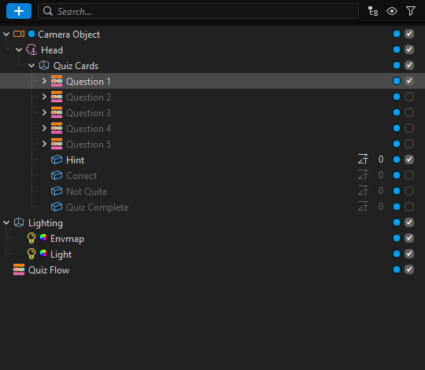
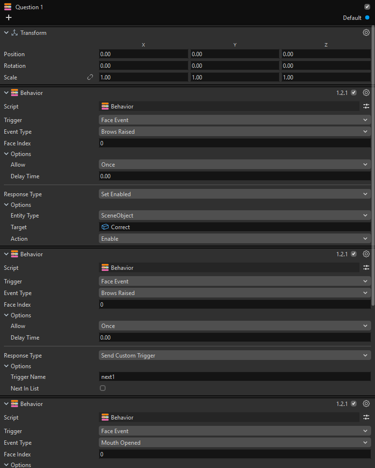

# Lens 6 – AR Quiz Lens

**What you will build:** A quiz that floats above your head. A question card appears with two answer cards beside it. Raise your eyebrows to pick the left answer, or open your mouth to pick the right one. The lens tells you if you were right and moves on to the next question.
**XR concept:** Face tracking, facial-expression input, the built-in Behavior script (no code)
**Lens Studio version:** 5.25 (Windows and macOS)
**Time:** about 40 minutes

## Assets you need

From `lens-studio/assets/`:
- `textures/quiz/` (the picture cards: questions, answers and messages)

This lens uses **no custom scripts**. Everything is done with Lens Studio's built-in **Behavior** script, which works as "if this happens, do that".

## How it works

Lens Studio can follow your head. A **Head Binding** object sticks to your head. Every card in this lens is a flat picture object inside it, so the cards float around your head and move with it.

A **Behavior** script has a **trigger** (what to wait for) and a **response** (what to do). Here the triggers are face expressions:

| Expression | Trigger in Behavior | Used for |
|------------|---------------------|----------|
| Eyebrows raised | Face Event > Brows Raised | The left answer |
| Mouth open | Face Event > Mouth Opened | The right answer |

Each question is a group of three cards. Only one question is switched on at a time. A Behavior on a switched-off object does nothing, so a question only listens for your face while it is showing. That is the trick that makes this quiz work without any code.

When you answer:
1. A Behavior switches on the **Correct** or **Not Quite** card.
2. A second Behavior sends a **custom trigger** called `next1`, `next2` and so on, a bit like ringing a bell.
3. After a short wait, some Behaviors on the `Quiz Flow` object hear the bell. They switch off the question and the feedback card, and switch on the next question.

After the last question the **Quiz Complete** card appears.

## Steps

### Step 1 – Create a new project

1. Open Lens Studio and choose **File > New Project**, or copy the `_lens-template` folder and open it.
2. Save it as `006-ar-quiz-lens`.

### Step 2 – Follow the head

1. In the **Scene Hierarchy**, click **+** and add a **Head Binding** object. Rename it `Head`.
2. Make sure it sits inside `Camera Object`.
3. The preset adds an occluder and an Effects group you don't need. Delete them.

### Step 3 – Make the picture cards

Every card is a flat picture object, called a sprite. You make one card, then copy it.

1. Drag all the pictures from `lens-studio/assets/textures/quiz/` into the **Asset Browser**.
2. Add a **Plane** mesh (**Add New > Mesh > Plane**) to the Asset Browser.
3. Add a new **Uber Unlit** material and name it `Card question-01`. In the material, set **Blend Mode** to **Normal** (so the see-through corners work), switch **Two Sided** on, and set **Base Texture** to `question-01`.
4. In the Scene Hierarchy, inside `Head`, add an empty object named `Quiz Cards`. Inside it add an empty object named `Question 1`.
5. Inside `Question 1`, add an empty object named `Question`. Add a **Render Mesh Visual** to it, set its **Mesh** to `Plane` and its **Material** to `Card question-01`.
6. Set its Transform: **Position** 0, 24, 8, **Rotation** 90, 0, 0 and **Scale** 32, 1, 8.75. (A plane lies flat by default, so the rotation stands it up. Scale Z is the height.)
7. Duplicate it twice for the two answers. Give each its own material (`Card left-01`, `Card right-01`) using the pictures `left-01` and `right-01`, and these transforms:

| Card | Position | Rotation | Scale |
|------|----------|----------|-------|
| Question | 0, 24, 8 | 90, 0, 0 | 32, 1, 8.75 |
| Left Answer | -16, 12, 8 | 90, 0, 0 | 18, 1, 4.5 |
| Right Answer | 16, 12, 8 | 90, 0, 0 | 18, 1, 4.5 |

8. Duplicate `Question 1` four times to make `Question 2` to `Question 5`. In each, swap the three materials for the matching numbers (`question-02`, `left-02`, `right-02`, and so on).
9. Also inside `Quiz Cards`, add the four message cards, each with its own material and a **Rotation** of 90, 0, 0:

| Card | Picture | Position | Scale |
|------|---------|----------|-------|
| Hint | `message-hint` | 0, -26, 8 | 30, 1, 4.36 |
| Correct | `message-correct` | 0, 38, 8 | 20, 1, 5.3 |
| Not Quite | `message-wrong` | 0, 38, 8 | 20, 1, 5.3 |
| Quiz Complete | `message-done` | 0, 30, 8 | 24, 1, 6.9 |

10. Select `Quiz Cards` and set its **Position** to 0, 4, 0 and its **Scale** to 0.66, 0.66, 0.66. This shrinks the whole set to a good size for a face.
11. Switch **off** (untick) `Question 2` to `Question 5`, `Correct`, `Not Quite` and `Quiz Complete`. They should appear only when the quiz reaches them.

### Step 4 – Answer with the face

On each `Question` group you add four **Behavior** components: two for the left answer and two for the right.

1. Select `Question 1`. Choose **Add Component > Behavior**.
2. Set the first Behavior like this (the left answer is correct for question 1):

| Setting | Value |
|---------|-------|
| Trigger | Face Event |
| Event Type | Brows Raised |
| Allow | Once |
| Response Type | Set Enabled |
| Target | `Correct` (the card to show if this answer is right) |
| Action | Enable |

3. Add a second Behavior with the same trigger and Allow, and set:

| Setting | Value |
|---------|-------|
| Response Type | Send Custom Trigger |
| Trigger Name | `next1` |

4. Repeat both for the right answer, with Event Type **Mouth Opened**. Because the right answer is wrong for question 1, point the first Behavior's Target at `Not Quite`.

5. Do the same on `Question 2` to `Question 5`, using the trigger names `next2` to `next5`. Choose **Correct** or **Not Quite** to match each question's right answer:

| Question | Left answer | Right answer | Correct side |
|----------|-------------|--------------|--------------|
| 1. What does AR stand for? | Augmented Reality | Artificial Reality | Left |
| 2. What unit does Lens Studio use? | Metre | Centimetre | Right |
| 3. Which tracking puts objects on a table? | Face tracking | Surface tracking | Right |
| 4. What does a marker tracker look for? | A known picture | Your hand | Left |
| 5. Which axis points up? | Y | Z | Left |

### Step 5 – Move to the next question

1. Add an empty object at the top level called `Quiz Flow`. It stays on all the time.
2. For each question number N from 1 to 5, add these Behaviors to it. Every one has **Trigger** = Custom Trigger, **Trigger Name** = `nextN`, **Delay Time** = 1.5 (seconds, so you can read the feedback) and **Response Type** = Set Enabled:

| Target | Action |
|--------|--------|
| `Question N` | Disable |
| `Correct` | Disable |
| `Not Quite` | Disable |
| `Question N+1` | Enable |

3. For the last question (N = 5), replace the last row with two: **Enable** `Quiz Complete` and **Disable** `Hint`.

That is 21 Behaviors on `Quiz Flow`, plus 20 on the questions. It looks like a lot, but each one is a single "if this, then that", and they are quick to copy.

### Step 6 – Choose the camera

In **Project Info**, set **Camera** to **Front**, so the phone looks at you.

### Step 7 – Test on your phone

1. Pair your phone with Lens Studio and send the lens (the **Send to Snapchat** button).
2. Hold the phone at arm's length and look at it.
3. Raise your eyebrows for the left answer, or open your mouth for the right one.

You can also test in Lens Studio: in the **Preview** panel, choose one of the sample videos under **Raise Eyebrows** or **Open Mouth** to act out an answer.

## What each part does

| Part | What it does |
|------|--------------|
| Head | Follows your head, so the cards float around it |
| Quiz Cards | Holds every card. Its scale sets how big they all are |
| Question 1 to 5 | One question each: a question card and two answer cards, plus four Behaviors that listen for your face |
| Hint, Correct, Not Quite, Quiz Complete | The message cards, switched on and off by Behaviors |
| Quiz Flow | Hears the `next` triggers and moves from one question to the next |

## Make it your own

- Change the questions. Edit the `QUESTIONS` list in `assets/textures/quiz/make-quiz-cards.py` and run it, import the new pictures and swap them in. Update the Correct and Not Quite targets to match.
- Use different expressions. Pick **Smile Started** or **Kiss Started** as the Event Type instead.
- Add a sound: add a Behavior with the same trigger and the response **Play Sound**.
- Make each card pop in with a Behavior response of **Run Tween**.

## Troubleshooting

| Problem | Fix |
|---------|-----|
| Nothing appears | Check Camera is set to Front, and that `Head` is inside `Camera Object` |
| The cards are huge or tiny | Change the **Scale** of `Quiz Cards` |
| A card is invisible | Check its material's **Blend Mode** is Normal, and that its Mesh is `Plane` |
| A card is a black box | The picture hasn't finished importing. Wait a minute, or delete it and import it again |
| It never answers | Check the Behaviors are on the question group and that the Event Type is right. A Behavior set to **Once** only fires once per run |
| The next question never comes | Check the `nextN` names match exactly in the question Behaviors and in `Quiz Flow` |
| Two cards sit on top of each other | Check every card except `Question 1` and `Hint` starts switched off |

## Credits

The picture cards were made for this course. Their lettering is drawn in Arial Rounded MT Bold.
