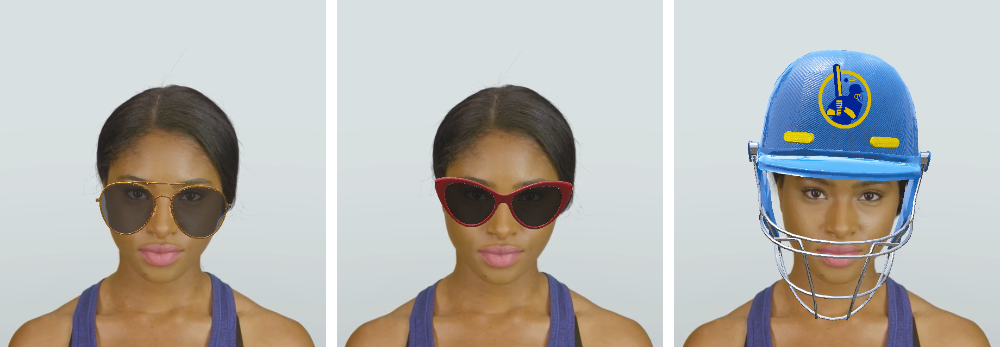
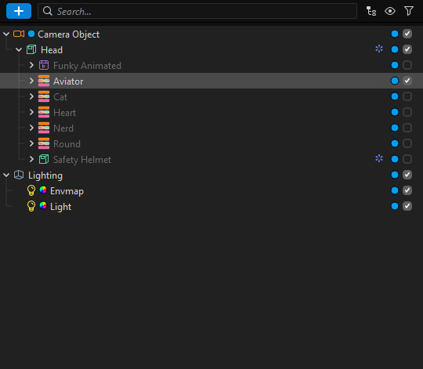
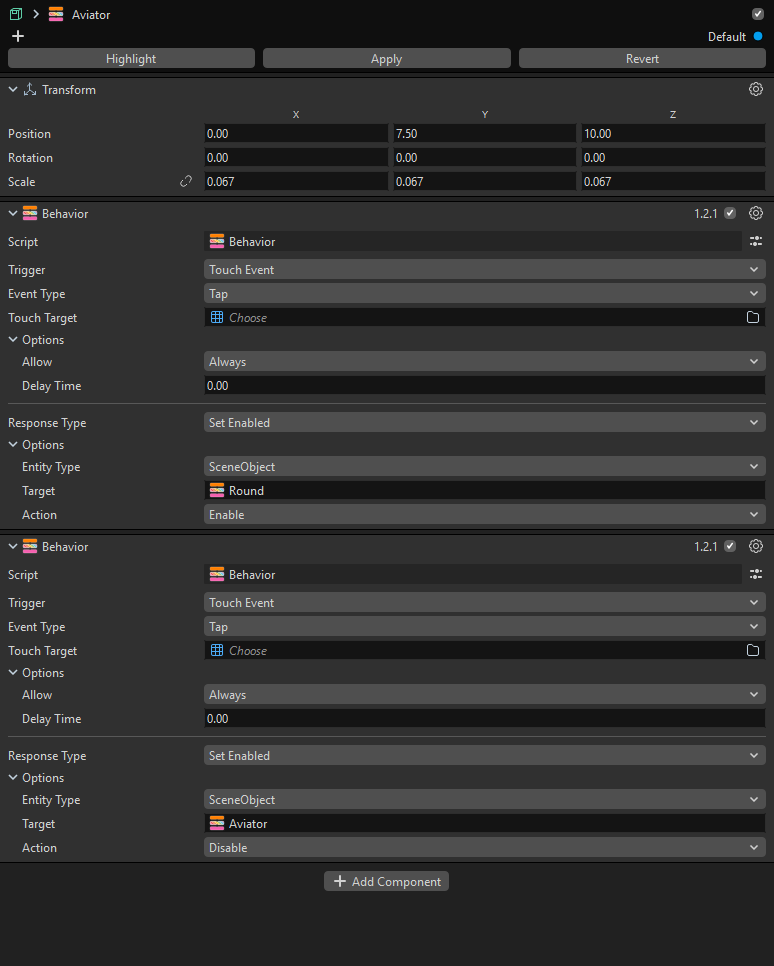

# Lens 7 – Virtual Try-On

**What you will build:** A try-on lens. Glasses and a safety helmet sit on your face and follow your head. Tap the screen to try the next one.
**XR concept:** Face tracking, 3D accessories (retail and industry use cases), the built-in Behavior script (no code)
**Lens Studio version:** 5.25 (Windows and macOS)
**Time:** about 20 minutes

## Assets you need

There is nothing to download from this repository. Both models come from the **Asset Library** inside Lens Studio:

- **Glasses Pack** (six pairs of glasses)
- **Cricket Helmet** (used here as the safety helmet)

This lens uses **no custom scripts**, only the built-in **Behavior** script.

## How it works

A **Head Binding** object sticks to your head and moves and turns with it. Anything placed inside it goes along. Here it holds seven items: six pairs of glasses and one helmet. Only one is switched on at a time.

Each item has two **Behavior** scripts that wait for a tap. When you tap the screen, the one that is showing switches itself off and switches the next one on. That is how the lens cycles through the items without any code.

## Steps

### Step 1 – Create a new project

1. Open Lens Studio and choose **File > New Project**, or copy the `_lens-template` folder and open it.
2. Save it as `007-virtual-try-on`.

### Step 2 – Get the models

1. Open the **Asset Library** (the window icon at the top, or **Window > Asset Library**).
2. Search for **Glasses Pack** and click **Import**. Lens Studio adds a prefab called `Glasses (PUT UNDER MAIN CAM)` to the scene. It already has a Head Binding.
3. Search for **Cricket Helmet** and click **Import**. A `CricketHelmet` object appears in the scene.

### Step 3 – Put everything on the head

1. Drag the glasses object inside `Camera Object`, and rename it `Head`.
2. Drag the helmet inside `Head`, and rename it `Safety Helmet`.
3. Select `Safety Helmet` and set its Transform:

| Setting | Value | Why |
|---------|-------|-----|
| Position | 0, 3, -2 | Sits on top of the head, not on the nose |
| Scale | 1.8, 1.8, 1.8 | Big enough to cover a real head |

4. Switch **off** (untick) every item except `Aviator`: `Round`, `Nerd`, `Cat`, `Heart`, `Funky Animated` and `Safety Helmet`.

### Step 4 – Tap to change

Pick an order, such as `Aviator`, `Round`, `Nerd`, `Cat`, `Heart`, `Funky Animated`, `Safety Helmet`. On **each** item, add two **Behavior** components (**Add Component > Behavior**).

For the first Behavior on `Aviator`:

| Setting | Value |
|---------|-------|
| Trigger | Touch Event |
| Event Type | Tap |
| Allow | Always |
| Response Type | Set Enabled |
| Target | `Round` (the next item) |
| Action | Enable |

For the second Behavior on `Aviator`:

| Setting | Value |
|---------|-------|
| Trigger | Touch Event |
| Event Type | Tap |
| Allow | Always |
| Response Type | Set Enabled |
| Target | `Aviator` (itself) |
| Action | Disable |

Repeat on every item, each time pointing the first Behavior at the next item in your order. For the last item, `Safety Helmet`, point it back at `Aviator`, so the loop goes round.

A Behavior on a switched-off item does nothing, so only the item you can see is listening for the tap.

### Step 5 – Choose the camera

In **Project Info**, set **Camera** to **Front**, so the phone looks at you.

### Step 6 – Test on your phone

1. Pair your phone with Lens Studio and send the lens (the **Send to Snapchat** button).
2. Look at the phone. Aviator glasses appear on your face.
3. Tap the screen to change to the next pair, and keep tapping to reach the helmet.

You can also test in Lens Studio. In the **Preview** panel, choose a sample face video, then click in the preview to tap.

## What each part does

| Part | What it does |
|------|--------------|
| Head | A Head Binding. It follows your head, so everything inside it does too |
| Aviator, Round, Nerd, Cat, Heart, Funky Animated | The six pairs of glasses. Each has a face occluder, so the arms disappear behind your ears |
| Safety Helmet | A helmet with a metal grid in front |
| Behavior scripts | Switch each item off and the next one on when you tap |

## Make it your own

- Add more items: put any hat, mask or glasses from the Asset Library inside `Head`, switched off, and add two Behaviors to link it into the loop.
- Change the trigger from **Tap** to **Mouth Opened** or **Smile Started** for a hands-free change.
- Add a **Play Sound** response to each Behavior, so every change has a "pop".
- Find a hard hat model on Sketchfab (CC BY) for a real safety helmet.

## Troubleshooting

| Problem | Fix |
|---------|-----|
| Nothing appears | Check Camera is set to Front, that `Head` is inside `Camera Object`, and that `Aviator` is switched on |
| Nothing changes when I tap | Check each item's first Behavior points at the next item, and its second points at itself |
| Two items at once | Check every item except `Aviator` is switched off at the start |
| The glasses sit too low or high | Move or scale the item inside `Head` |
| The helmet covers my eyes | Raise its Position Y, or increase its Scale |
| It skips an item | Each item must have exactly one Enable and one Disable Behavior |

## Credits

"Glasses Pack" and "Cricket Helmet" are from the Lens Studio Asset Library, free to use in lenses.
