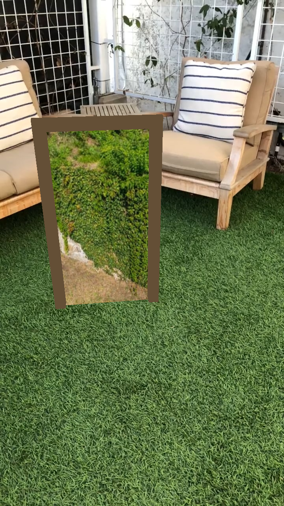
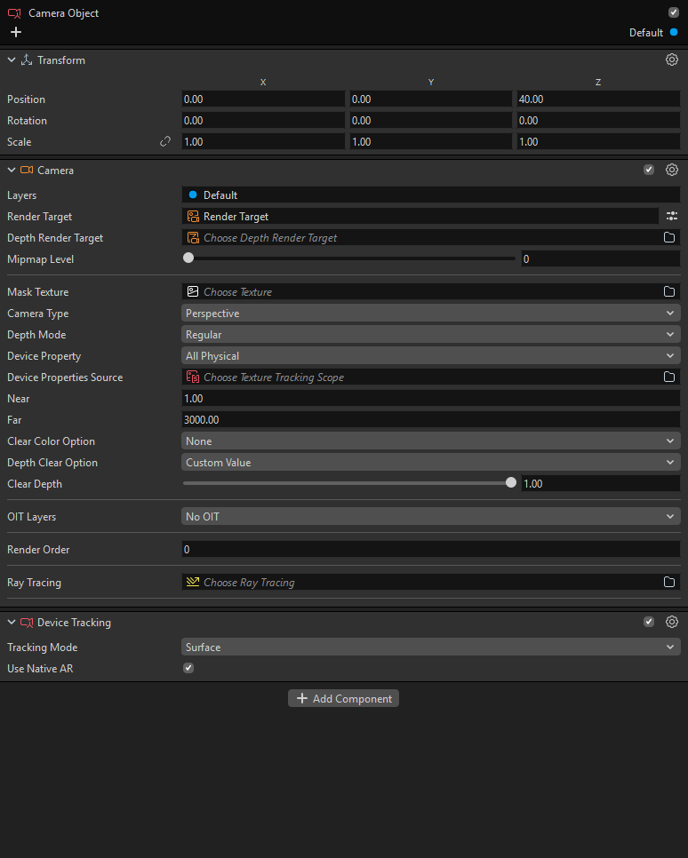
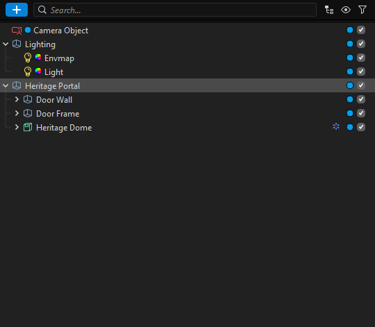

# Lens 8 – Portal to a Heritage Site

**What you will build:** A doorway that stands on the floor in front of you. Look through it and you see a 360° fortress. Walk through it, and you are standing inside the scene.
**XR concept:** Surface tracking, portals and 360° environments
**Lens Studio version:** 5.25 (Windows and macOS)
**Time:** about 30 minutes

## Assets you need

From `lens-studio/assets/`:
- `models/heritage-dome.obj` (half a sphere that the picture is painted on)
- `textures/heritage/panorama-fortress.jpg` (the 360° picture)

This lens uses **no scripts at all**. The portal is made from shapes and materials.

## How it works

A portal is a trick. The 360° scene is really painted on the inside of a big half sphere (a dome) sitting behind the doorway. A huge invisible wall, with a door-shaped hole cut out of it, stands in front of the dome:

- The wall uses an **Occluder** material. An occluder hides everything behind it, but shows the camera picture in its place, so the wall looks like thin air.
- Where the hole is, nothing hides the dome, so you see the fortress through the doorway.
- When you walk through the hole, you are inside the dome and the fortress is all around you.

Three things make it work:
1. **Surface tracking** keeps the doorway fixed to the floor as you move the phone.
2. The **occluder wall** hides the dome everywhere except the doorway.
3. The **dome** has the picture's middle half, so that looking forward from the door shows the main view.

## Steps

### Step 1 – Create a new project

1. Open Lens Studio and choose **File > New Project**, or copy the `_lens-template` folder and open it.
2. Save it as `008-heritage-site-portal`.

### Step 2 – Track the floor

1. Select `Camera Object` and add a **Device Tracking** component (**Add Component > Device Tracking**).
2. Set **Tracking Mode** to **Surface**, and switch **Use Native AR** on. Native AR uses the phone's own tracking, which is steadier.
3. In the **Camera** component, set **Far** to 3000, so the big dome isn't cut off.

### Step 3 – Make the portal

1. Add an empty object named `Heritage Portal` and set its **Position** to 0, 0, -250. Everything below goes inside it. The portal is now 2.5 metres in front of you, on the floor.
2. Drag `heritage-dome.obj` and `panorama-fortress.jpg` into the **Asset Browser**.
3. Add a **Plane** mesh and a **Box** mesh (**Add New > Mesh**) to the Asset Browser.
4. Add three materials: an **Occluder** material named `Door Wall`, an **Uber Unlit** material named `Door Stone` (colour: sandstone brown, 0.78, 0.62, 0.42), and an **Uber Unlit** material named `Heritage Panorama`. On `Heritage Panorama`, set **Base Texture** to `panorama-fortress` and switch **Two Sided** on.
5. Drag the dome from the Asset Browser into `Heritage Portal` and rename it `Heritage Dome`. Set its **Position** to 0, 105, -20 and its **Scale** to 400, 400, 400. In its **Render Mesh Visual**, set the **Material** to `Heritage Panorama`.

The door is 100 cm wide and 210 cm tall, and its bottom sits on the floor (y = 0).

6. Add an empty object `Door Wall` inside `Heritage Portal`. Inside it add four objects, each with a **Render Mesh Visual** using the `Plane` mesh and the `Door Wall` material, and each with **Rotation** 90, 0, 0:

| Object | Position | Scale |
|--------|----------|-------|
| Wall Left | -1250, 0, 0 | 2400, 1, 2400 |
| Wall Right | 1250, 0, 0 | 2400, 1, 2400 |
| Wall Above Door | 0, 705, 0 | 100, 1, 990 |
| Wall Below Door | 0, -600, 0 | 100, 1, 1200 |

The four pieces surround a gap exactly 100 cm wide and 210 cm tall. A plane lies flat, so the rotation of 90 stands it up and the Z scale becomes its height.

7. Add an empty object `Door Frame` inside `Heritage Portal`. Inside it add three objects with **Render Mesh Visual** using the `Box` mesh and the `Door Stone` material:

| Object | Position | Scale |
|--------|----------|-------|
| Post Left | -56, 105, 0 | 12, 210, 12 |
| Post Right | 56, 105, 0 | 12, 210, 12 |
| Lintel | 0, 216, 0 | 124, 12, 12 |

### Step 4 – Choose the camera

In **Project Info**, set **Camera** to **Rear**, so the phone looks at the room.

### Step 5 – Test on your phone

1. Pair your phone with Lens Studio and send the lens (the **Send to Snapchat** button).
2. Point the phone at the floor and move it a little, until the doorway appears.
3. Look through the door. Then walk forward, through the doorway.

Walk slowly and keep the phone steady. In the Lens Studio preview, the camera doesn't move like a real walk, so the real effect needs a phone.

## What each part does

| Part | What it does |
|------|--------------|
| Device Tracking (Surface) | Keeps the doorway fixed to the floor as you move |
| Door Wall | Four invisible plates with a hole. They hide the dome except in the doorway |
| Door Frame | The stone doorway you can see |
| Heritage Dome | Half a sphere with the 360° picture on its inside |

## Make it your own

- Use your own place: replace `panorama-fortress.jpg` with any 360° picture (a 2:1 "equirectangular" photo). Many phones can take one.
- Turn the picture: if the best view isn't straight ahead, rotate `Heritage Dome` around Y.
- Change the doorway: make it an arch, add steps, or tint the frame.
- Add a sound of the place with an **Audio Component**.

## Troubleshooting

| Problem | Fix |
|---------|-----|
| I see the picture all around me, not just in the door | Check the four wall plates use the **Occluder** material and sit at Z = 0 inside the portal |
| The door shows only the camera | Check the dome's Scale is 400 and its Material has the panorama. Check the camera's **Far** is 3000 |
| The picture is mirrored or backwards | Turn the dome 180 on Y, and check the material is **Two Sided** |
| The picture is blurry | Use a larger 360° picture, such as 4096 × 2048 |
| The door floats above or sinks into the floor | Surface tracking sets the floor. Check the portal's Position Y is 0 |
| The door slides around | Switch **Use Native AR** on and move the phone slowly |

## Credits

"Veste Oberhaus (Passau, full spherical panoramic image, equirectangular projection)" by Jürgen Matern, 2018, on Wikimedia Commons, licensed under [CC BY-SA 4.0](https://creativecommons.org/licenses/by-sa/4.0/). [Original picture](https://commons.wikimedia.org/wiki/File:Veste_Oberhaus_(Passau,_full_spherical_panoramic_image,_equirectangular_projection).jpg).

The picture used here has been resized, sharpened and turned so the castle is straight ahead. Because the licence says "share alike", the changed picture (`panorama-fortress.jpg`) is shared under the same CC BY-SA 4.0 licence. The dome and the door were made for this course.
