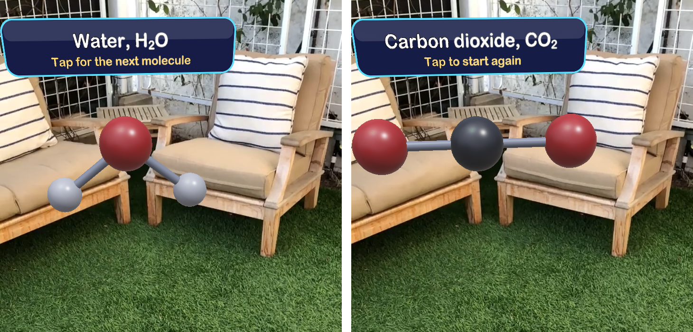

# Lens 9 – Chemistry Molecule Builder

**What you will build:** Tap to add atoms on a surface and watch bonds form, such as H₂O or CO₂.
**XR concept:** Surface tracking, tap interaction, scripting
**Course day:**
**Lens Studio version:**
**Time:** about __ minutes

## Assets you need
From `lens-studio/assets/`:
- `models/...`
- `textures/...`

## Steps

### Step 1 – Create a new project
What to click and what you should see.

### Step 2 – …

## Test on your phone
How to pair Lens Studio with Snapchat and preview.

## Make it your own
Ideas for participants to change or extend the lens.

## Troubleshooting
| Problem | Fix |
|---------|-----|
