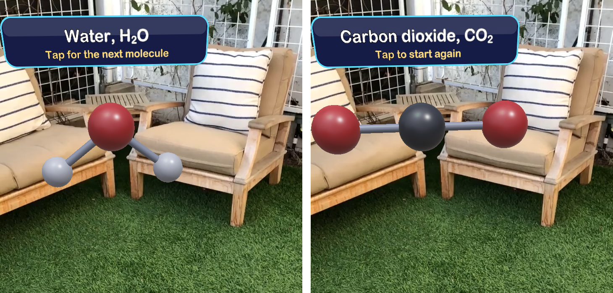
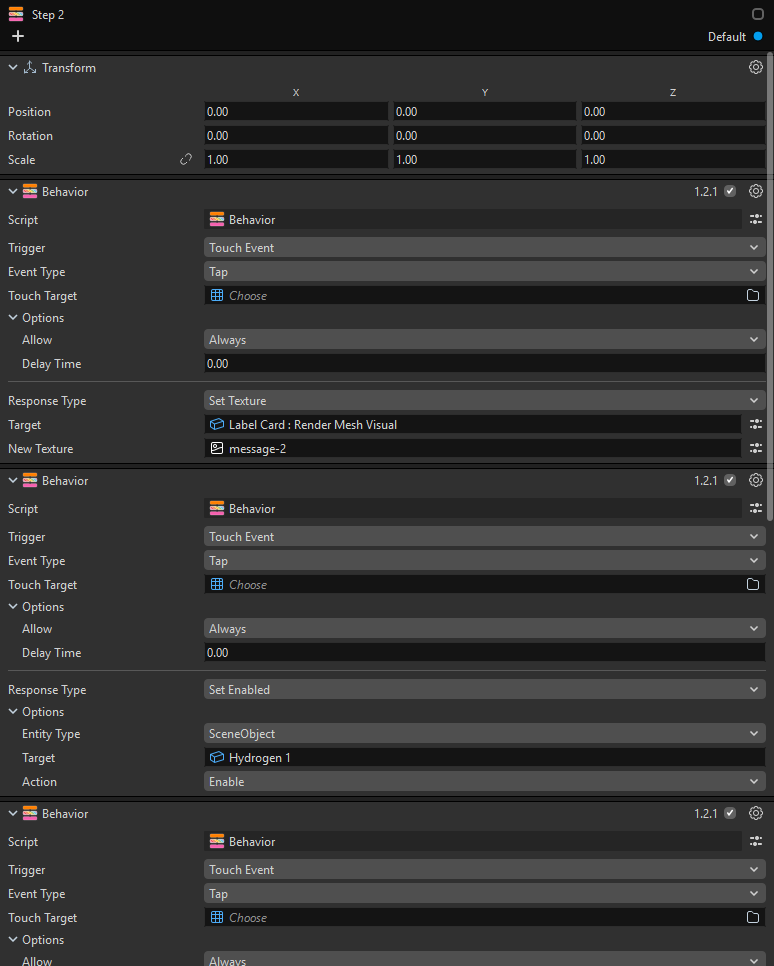
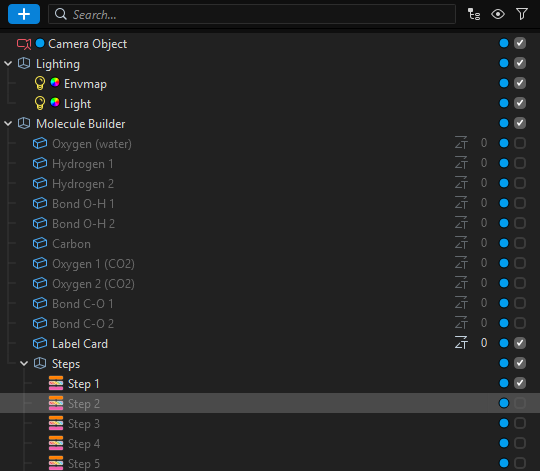

# Lens 9 – Chemistry Molecule Builder

**What you will build:** A molecule you build by tapping. Each tap adds one atom and its bond, until you have a water molecule (H₂O). Tap again to start carbon dioxide (CO₂), and again to begin once more.
**XR concept:** Surface tracking, tap interaction, and the built-in Behavior script (no code)
**Lens Studio version:** 5.25 (Windows and macOS)
**Time:** about 40 minutes

## Assets you need

From `lens-studio/assets/`:
- `textures/molecules/` (seven message cards, such as "Water, H₂O")

The atoms and bonds are made from a sphere, a cylinder and a few colours inside Lens Studio. This lens uses **no custom scripts**.

## How it works

A molecule is atoms joined by bonds. Here each atom is a sphere and each bond is a thin cylinder. They are all in the scene from the start, but switched **off**. A row of **step** objects switches them on, one tap at a time:

| Tap | What appears | Message |
|-----|--------------|---------|
| 1 | Oxygen | Oxygen (O). Tap to add hydrogen |
| 2 | Hydrogen and a bond | Hydrogen (H). One more! |
| 3 | A second hydrogen and bond | Water, H2O! Tap for the next one |
| 4 | Water goes away. Carbon appears | Carbon (C). Tap to add oxygen |
| 5 | Oxygen and a bond | Oxygen (O). One more! |
| 6 | A second oxygen and bond | Carbon dioxide, CO2! Tap to restart |
| 7 | CO₂ goes away | Tap to add an atom |

Only one step is switched on at a time. A **Behavior** script on a switched-off object does nothing, so the next tap is handled only by the current step. Each step does its jobs and then switches itself off and the next step on.

The colours follow the standard chemistry scheme: oxygen is red, hydrogen is white and carbon is dark grey.

## Steps

### Step 1 – Create a new project

1. Open Lens Studio and choose **File > New Project**, or copy the `_lens-template` folder and open it.
2. Save it as `009-chemistry-molecule-builder`.

### Step 2 – Track the surface

1. Select `Camera Object` and add a **Device Tracking** component (**Add Component > Device Tracking**).
2. Set **Tracking Mode** to **Surface** and switch **Use Native AR** on.

The molecule will now stay put in the room as you walk around it.

### Step 3 – Make the atoms and bonds

1. Add a **Sphere** mesh and a **Cylinder** mesh to the Asset Browser (**Add New > Mesh**). Both are 1 cm wide, so the Scale you give them is their size in centimetres.
2. Add four **Simple PBR** materials named `Atom Oxygen`, `Atom Hydrogen`, `Atom Carbon` and `Bond`. Set each **Base Color** and **Roughness**:

| Material | Base Color | Roughness |
|----------|-----------|-----------|
| Atom Oxygen | red (0.92, 0.18, 0.18) | 0.35 |
| Atom Hydrogen | white (0.95, 0.95, 0.97) | 0.35 |
| Atom Carbon | dark grey (0.22, 0.23, 0.26) | 0.35 |
| Bond | light grey (0.70, 0.72, 0.78) | 0.30 |

3. Add an empty object named `Molecule Builder`. Set its **Position** to 0, 30, -100 and its **Scale** to 2.5, 2.5, 2.5. This sets where the molecule floats and how big it is.
4. Inside it add ten objects, each with a **Render Mesh Visual**. The atoms use the `Sphere` mesh, the bonds use the `Cylinder` mesh:

| Object | Mesh | Material | Position | Scale |
|--------|------|----------|----------|-------|
| Oxygen (water) | Sphere | Atom Oxygen | 0, 0, 0 | 9, 9, 9 |
| Hydrogen 1 | Sphere | Atom Hydrogen | -11.07, -8.58, 0 | 6, 6, 6 |
| Hydrogen 2 | Sphere | Atom Hydrogen | 11.07, -8.58, 0 | 6, 6, 6 |
| Carbon | Sphere | Atom Carbon | 0, 0, 0 | 9, 9, 9 |
| Oxygen 1 (CO2) | Sphere | Atom Oxygen | -16, 0, 0 | 9, 9, 9 |
| Oxygen 2 (CO2) | Sphere | Atom Oxygen | 16, 0, 0 | 9, 9, 9 |

5. The four bonds are cylinders. A cylinder stands up along its Y axis, so you set its length with the Y scale and turn it with the Z rotation:

| Object | Position | Rotation | Scale |
|--------|----------|----------|-------|
| Bond O-H 1 | -5.535, -4.29, 0 | 0, 0, -52.25 | 1.6, 14, 1.6 |
| Bond O-H 2 | 5.535, -4.29, 0 | 0, 0, 52.25 | 1.6, 14, 1.6 |
| Bond C-O 1 | -8, 0, 0 | 0, 0, 90 | 1.6, 16, 1.6 |
| Bond C-O 2 | 8, 0, 0 | 0, 0, 90 | 1.6, 16, 1.6 |

The 104.5° angle between the two hydrogens in water is the real shape of an H₂O molecule.

6. Switch **off** (untick) all ten atoms and bonds. They will appear one by one as you tap.

### Step 4 – Add the message card

The words are a picture card, not 3D text. A picture stays crisp and clear on any background, and has the small lowered numbers in H₂O that plain 3D text cannot draw.

1. Drag the seven `message-` pictures from `lens-studio/assets/textures/molecules/` into the **Asset Browser**.
2. Add a **Plane** mesh to the Asset Browser, and an **Uber Unlit** material named `Label Card`. Set its **Blend Mode** to **Normal** (so the rounded corners are see-through), switch **Two Sided** on, and set its **Base Texture** to `message-0`.
3. Inside `Molecule Builder`, add an object `Label Card` with a **Render Mesh Visual** (Mesh `Plane`, Material `Label Card`). Set its **Position** to 0, 15, 0, **Rotation** to 90, 0, 0 and **Scale** to 36, 1, 8.5. (A plane lies flat, so the rotation stands it up. Scale Z is its height.)

### Step 5 – Make it react to taps

1. Add an empty object `Steps` inside `Molecule Builder`. Inside it add seven empty objects named `Step 1` to `Step 7`.
2. Switch **off** `Step 2` to `Step 7`. Only `Step 1` starts switched on.
3. On each step, add **Behavior** components (**Add Component > Behavior**). Every one has **Trigger** = Touch Event, **Event Type** = Tap and **Allow** = Always. Only the response changes. Each step needs the following, **in this order**:

| Step | Responses (in order) |
|------|----------------------|
| Step 1 | Set Texture: `message-1`. Enable `Oxygen (water)` |
| Step 2 | Set Texture: `message-2`. Enable `Hydrogen 1`, `Bond O-H 1` |
| Step 3 | Set Texture: `message-3`. Enable `Hydrogen 2`, `Bond O-H 2` |
| Step 4 | Set Texture: `message-4`. Disable `Oxygen (water)`, `Hydrogen 1`, `Hydrogen 2`, `Bond O-H 1`, `Bond O-H 2`. Enable `Carbon` |
| Step 5 | Set Texture: `message-5`. Enable `Oxygen 1 (CO2)`, `Bond C-O 1` |
| Step 6 | Set Texture: `message-6`. Enable `Oxygen 2 (CO2)`, `Bond C-O 2` |
| Step 7 | Set Texture: `message-0`. Disable `Carbon`, `Oxygen 1 (CO2)`, `Oxygen 2 (CO2)`, `Bond C-O 1`, `Bond C-O 2` |

For a **Set Texture** response, set **Target** to the `Label Card` mesh and **New Texture** to the picture. For **Enable** and **Disable**, use **Response Type** = Set Enabled with the object as the **Target**.

4. Last on every step, add two more Behaviors: **Enable** the next step (Step 7 enables Step 1), then **Disable** the step itself.

**Order matters.** Switching a step off stops its other Behaviors from running, so the "Disable itself" Behavior must be the last one on every step.

### Step 6 – Choose the camera

In **Project Info**, set **Camera** to **Rear**, so the phone looks at the room.

### Step 7 – Test on your phone

1. Pair your phone with Lens Studio and send the lens (the **Send to Snapchat** button).
2. Point the phone at a table or the floor, and tap the screen. Oxygen appears.
3. Keep tapping to build water, then carbon dioxide.

You can also test in the **Preview** panel: click in the preview to tap.

## What each part does

| Part | What it does |
|------|--------------|
| Device Tracking (Surface) | Keeps the molecule fixed in the room |
| Atoms and bonds | Spheres and cylinders, switched on and off one at a time |
| Label Card | A flat card whose picture changes to tell you what you just made |
| Step 1 to 7 | Each one waits for a tap, then does its jobs and passes on to the next |

## Make it your own

- Build another molecule: ammonia (NH₃) or methane (CH₄). Add the atoms and bonds, then add steps for them. Methane's real shape is a pyramid, so you can use Z positions too.
- Add a sound to each tap: add a Behavior with the response **Play Sound**.
- Make each atom pop in with a **Run Tween** response.
- Change the words: edit the `MESSAGES` list in `assets/textures/molecules/make-molecule-cards.py`, run it, and import the new pictures.

## Troubleshooting

| Problem | Fix |
|---------|-----|
| Nothing appears when I tap | Check `Step 1` is switched on, and every atom and bond is switched off at the start |
| The message doesn't change | Check the Set Texture Behavior is **before** the "Disable itself" Behavior, and its Target is the `Label Card` mesh |
| The card is a black box | The picture hasn't finished importing. Wait a minute, or delete it and import it again |
| The taps skip a step | Each step must enable only the next step. Check the targets |
| A bond points the wrong way | Check its Z rotation. A cylinder stands along Y, so a flat bond needs a Z rotation of 90 |
| The molecule is hidden behind the real world | Move `Molecule Builder` closer, or raise its Y |
| It is too small or big | Change the Scale of `Molecule Builder` |

## Credits

Nothing from outside was used. The atoms, bonds and message cards were made for this course. The lettering on the cards is drawn in Arial Rounded MT Bold.
