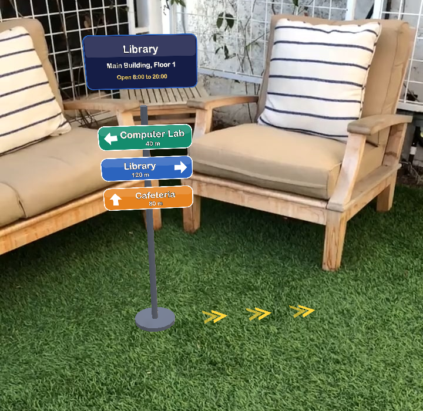
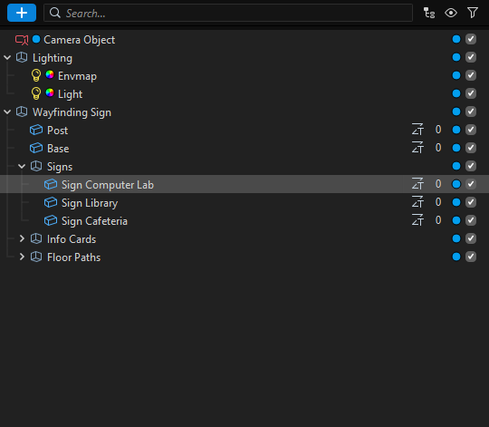
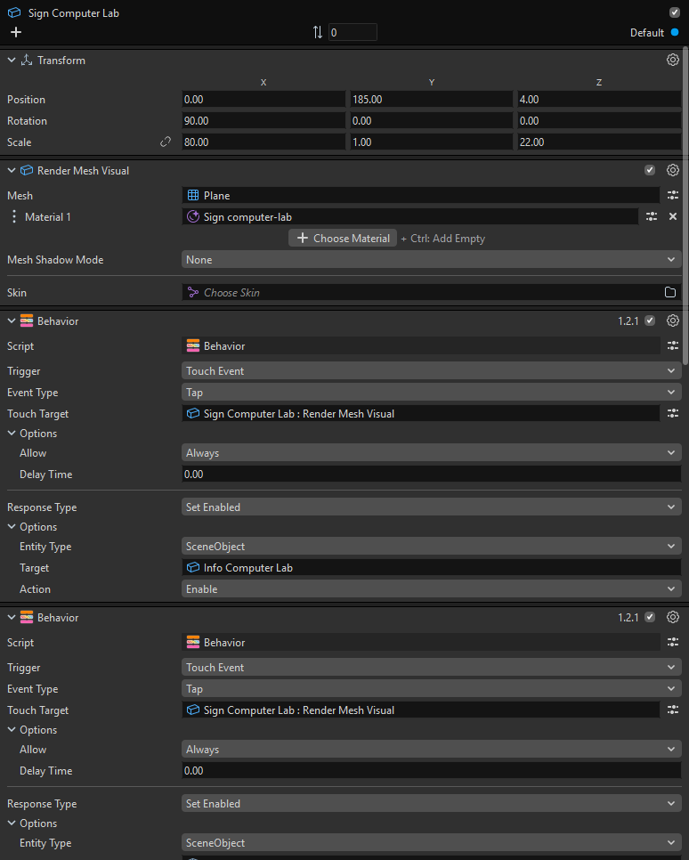

# Lens 10 – Campus Wayfinding Sign

**What you will build:** A signpost that stands on the ground in front of you, with no printed marker needed. It points the way to the Computer Lab, the Library and the Cafeteria. Tap a sign to open an information card and to light up a path of arrows on the floor.
**XR concept:** Surface tracking (markerless), spatial UI, and the built-in Behavior script (no code)
**Lens Studio version:** 5.25 (Windows and macOS)
**Time:** about 40 minutes

## Assets you need

From `lens-studio/assets/`:
- `textures/wayfinding/` (the sign boards, the information cards and the ground arrow)

This lens uses **no custom scripts** and **no printed marker**. The rear camera finds the ground and the sign stands on it.

## How it works

**Surface tracking** finds the floor or ground in the camera picture. Objects placed in the scene then stay fixed on that spot as you walk around.

The signpost is a thin grey post with three flat sign boards on it. Each board is a picture of an arrow, a place name and a distance. Each place also has two things that start switched **off**:

- an **information card** that floats above the post, and
- a **path** of three arrows lying on the ground, pointing the way.

A **Behavior** script on each sign waits for a tap on that sign. When it is tapped, it switches **on** the card and the path for that place, and switches **off** the cards and paths of the other two places.

## Steps

### Step 1 – Create a new project

1. Open Lens Studio and choose **File > New Project**, or copy the `_lens-template` folder and open it.
2. Save it as `010-campus-wayfinding-sign`.

### Step 2 – Track the ground

1. Select `Camera Object` and add a **Device Tracking** component (**Add Component > Device Tracking**).
2. Set **Tracking Mode** to **Surface** and switch **Use Native AR** on.
3. In the **Camera** component, set **Far** to 3000.

### Step 3 – Build the signpost

1. Drag all the pictures from `lens-studio/assets/textures/wayfinding/` into the **Asset Browser**.
2. Add a **Plane** mesh and a **Cylinder** mesh (**Add New > Mesh**). Both are 1 cm across, so a Scale is a size in centimetres.
3. Add a **Simple PBR** material named `Post Grey` with a grey **Base Color** (0.55, 0.58, 0.62).
4. Add an **Uber Unlit** material named `Card Template`. Set **Blend Mode** to **Normal** (so the rounded corners are see-through) and switch **Two Sided** on. Duplicate it seven times and name the copies `Sign computer-lab`, `Sign library`, `Sign cafeteria`, `Info computer-lab`, `Info library`, `Info cafeteria` and `Ground Arrow`. On each copy, set **Base Texture** to the picture with the matching name.
5. Add an empty object `Wayfinding Sign` and set its **Position** to 0, 0, -250. This puts the post 2.5 metres in front of you, on the ground. Everything below goes inside it.
6. Add the post. Both objects have a **Render Mesh Visual** with Mesh `Cylinder` and Material `Post Grey`:

| Object | Position | Scale |
|--------|----------|-------|
| Post | 0, 105, 0 | 6, 210, 6 |
| Base | 0, 2, 0 | 40, 4, 40 |

7. Add an empty object `Signs`, and inside it add three sign boards. Each has a **Render Mesh Visual** with Mesh `Plane`, its own `Sign` material, and **Rotation** 90, 0, 0. A plane lies flat, so the rotation stands it up. Its Z scale is its height:

| Object | Material | Position | Scale |
|--------|----------|----------|-------|
| Sign Computer Lab | Sign computer-lab | 0, 185, 4 | 80, 1, 22 |
| Sign Library | Sign library | 0, 158, 4 | 80, 1, 22 |
| Sign Cafeteria | Sign cafeteria | 0, 131, 4 | 80, 1, 22 |

8. Add an empty object `Info Cards`, and inside it three cards. Each has Mesh `Plane`, its own `Info` material, **Rotation** 90, 0, 0, **Position** 0, 245, 4 and **Scale** 90, 1, 42:

| Object | Material |
|--------|----------|
| Info Computer Lab | Info computer-lab |
| Info Library | Info library |
| Info Cafeteria | Info cafeteria |

9. Add an empty object `Floor Paths`. Inside it add three empty path objects, one for each place. Give each a **Rotation** that turns it towards its place:

| Object | Rotation | Points |
|--------|----------|--------|
| Path Computer Lab | 0, 90, 0 | Left |
| Path Library | 0, -90, 0 | Right |
| Path Cafeteria | 0, 0, 0 | Ahead, away from you |

10. Inside **each** path object add three chevrons named `Chevron 1`, `Chevron 2` and `Chevron 3`. Each has Mesh `Plane`, Material `Ground Arrow`, **Rotation** 0, 0, 0 and **Scale** 30, 1, 30. Give them **Position** 0, 1, -60 for the first, 0, 1, -105 for the second and 0, 1, -150 for the third. They lie flat on the ground, 1 cm above it so they don't flicker.
11. Switch **off** (untick) all three `Info` cards and all three `Path` objects. They start hidden.

### Step 4 – Make the signs tappable

Each sign gets six **Behavior** components (**Add Component > Behavior**). They all have **Trigger** = Touch Event, **Event Type** = Tap, **Touch Target** = that sign's own mesh, **Allow** = Always and **Response Type** = Set Enabled.

For **Sign Computer Lab**, the six Behaviors are:

| Target | Action |
|--------|--------|
| `Info Computer Lab` | Enable |
| `Path Computer Lab` | Enable |
| `Info Library` | Disable |
| `Path Library` | Disable |
| `Info Cafeteria` | Disable |
| `Path Cafeteria` | Disable |

Do the same on **Sign Library** and **Sign Cafeteria**, each time enabling its own card and path and disabling the other two.

The **Touch Target** makes the Behavior listen only for taps on that sign, not taps anywhere on the screen.

### Step 5 – Choose the camera

In **Project Info**, set **Camera** to **Rear**, so the phone looks at the world.

### Step 6 – Test on your phone

1. Pair your phone with Lens Studio and send the lens (the **Send to Snapchat** button).
2. Point the phone at the ground and move it slowly. The signpost appears and stays on the ground.
3. Tap a sign. Its information card opens and a path of arrows lights up on the ground.
4. Tap another sign to swap to that place.

You can also test in the **Preview** panel: click a sign in the preview to tap it.

## What each part does

| Part | What it does |
|------|--------------|
| Device Tracking (Surface) | Finds the ground and keeps the signpost fixed on it, with no marker |
| Post and Base | The signpost itself |
| Signs | The three boards. Tapping one opens its card and path |
| Info Cards | One card per place with the building and opening hours. Hidden until tapped |
| Floor Paths | Three flat arrows on the ground per place. Hidden until tapped |
| Behavior scripts | Switch the right card and path on, and the others off |

## Make it your own

- Use your own places. Edit the `PLACES` list in `assets/textures/wayfinding/make-wayfinding-cards.py` (names, distances and opening hours), run it, and swap in the new pictures.
- Add more signs: copy a sign, its card and its path, then add the extra Behaviors.
- Change the direction of a path: turn its **Rotation** Y.
- Add a sound to each tap with a Behavior response of **Play Sound**.
- Make the arrows roll along the ground with a **Run Tween** response.

## Troubleshooting

| Problem | Fix |
|---------|-----|
| The signpost doesn't appear | Check Camera is set to Rear and Device Tracking is in **Surface** mode. Move the phone slowly over the ground |
| The signpost floats above or sinks into the ground | Check `Wayfinding Sign` has Position Y = 0 |
| Tapping a sign does nothing | Check each Behavior's **Touch Target** is that sign's own mesh, and the Behaviors are on the sign |
| Two cards open at once | Check each sign disables the other two cards and paths |
| A path points the wrong way | Turn the path's Rotation Y by 180 |
| The signs are too small to read | Raise the **Scale** of `Wayfinding Sign` to 1.5 |
| A card is a black box | The picture hasn't finished importing. Wait a minute, or delete it and import it again |

## Credits

Nothing from outside was used. The signs, cards and arrow were made for this course. The lettering on them is drawn in Arial Rounded MT Bold.
