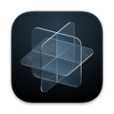

  
  &nbsp;
  

# Getting started with Lens Studio

Do this once, before the first Lens Studio session. It takes about **30 to 45 minutes**.

By the end you will have:

- [ ] a free **Snapchat account**
- [ ] **Lens Studio** installed and signed in
- [ ] the **Snapchat app** on your phone, to test your lenses
- [ ] **Visual Studio Code** set up for the few scripts in the guides (optional)

Lens Studio is free and does not need a separate licence.

## What you need

| Item | Details |
|------|---------|
| Computer | Windows 10 or 11 (64-bit), or a recent Mac. 16 GB of memory is best, 8 GB is the least |
| Free disk space | About 5 GB |
| Phone | An iPhone or Android phone that can run Snapchat |
| Email address | For your Snapchat account |

> The lenses in this course were built and tested on **Lens Studio 5.25**. Use that version, or a newer 5.x one, so your screen matches the guides.

## Step 1 – Create your Snapchat account

You sign in to Lens Studio with a Snapchat account, so you need one even if you never use Snapchat itself.

1. Install the **Snapchat** app on your phone from the App Store or Google Play, and open it.
2. Tap **Sign Up** and follow the steps: your name, birthday, a username, a password and your email or phone number.
3. **Verify** your email or phone number when Snapchat asks.

If you already have an account, you can use it. Remember its username and password.

## Step 2 – Install Lens Studio

1. On your computer, go to **ar.snap.com/download** and download **Lens Studio** for Windows or Mac.
2. Run the installer. On a Mac, drag Lens Studio into the **Applications** folder.
3. Open Lens Studio.
4. Choose **Sign in** and log in with your Snapchat username and password. The page may open in your web browser and send you back.
5. Accept the terms if Lens Studio asks.

When Lens Studio opens to its start screen, it is installed and signed in.

## Step 3 – Check it works

1. On the start screen, choose **New Project** and pick a blank or **Face** template.
2. Wait for the scene to open. You should see a **Preview** panel with a sample video.
3. Close the project. You don't need to save it.

If you can see the preview, Lens Studio is ready.

## Step 4 – Test on your phone

You will do this in every lens, so set it up now.

1. Make sure you are **signed in to the Snapchat app** on your phone with the **same account** you used in Lens Studio. Put your phone and computer on the **same Wi-Fi network** if you can.
2. In Lens Studio, open a project and click the **Send to Snapchat** button above the Preview panel. (It may be called **Push to Device** or **Pair** in other versions.)
3. If your phone is not found, choose **Pair a device** in that window. Lens Studio shows a Snapcode. In the Snapchat app, point the camera at the code and follow the prompts.
4. Lens Studio sends the lens to your phone. Open Snapchat and the lens appears in the camera. Allow the camera permission if the app asks.

Lenses stay on your phone for a few hours, and you can send them again at any time.

## Step 5 – Set up Visual Studio Code (optional)

Most lenses in this course are built without any code. A few guides include short scripts, and VS Code gives you a friendlier editor for them. It is free.

1. Go to **code.visualstudio.com** and download and install it.
2. In Lens Studio, find your project's folder: it contains a file ending in `.esproj`.
3. In VS Code, choose **File > Open Folder** and open that **project folder** (not only its `Assets` folder). Opening the whole folder lets VS Code read Lens Studio's built-in hints, so it can suggest code as you type.
4. Open a script from the `Assets` folder and edit it. When you **save** the file, Lens Studio notices the change and reloads it by itself.

VS Code understands TypeScript on its own, so you don't need to install anything extra.

## Problems?

| Problem | Fix |
|---------|-----|
| I can't sign in | Check your username and password at accounts.snapchat.com, then try again |
| The Preview panel is empty or black | Wait a moment. If it stays black, close and reopen the project |
| My phone isn't found | Check you are signed in to the same account, then choose **Pair a device** and scan the Snapcode |
| The lens doesn't appear in Snapchat | Open the app's camera and swipe to the lens carousel, or send the lens again |
| The camera view is dark in a lens | Allow Snapchat to use the camera in your phone's settings |
| My screen doesn't match the guide | Check your Lens Studio version. Open **Lens Studio > About** (on Windows, **Help > About**) |

## Next

Open the [Lens Studio lenses](README.md) and start with the first one.
