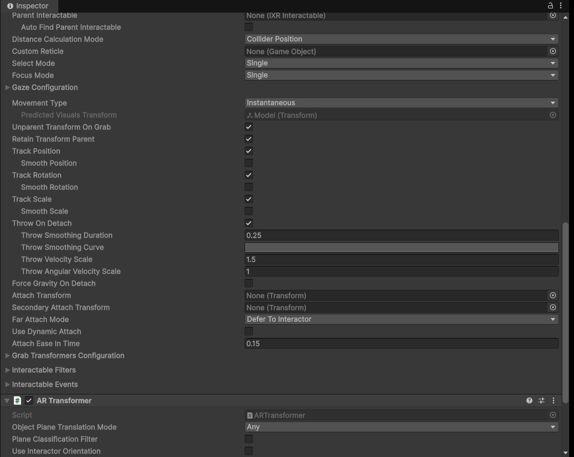
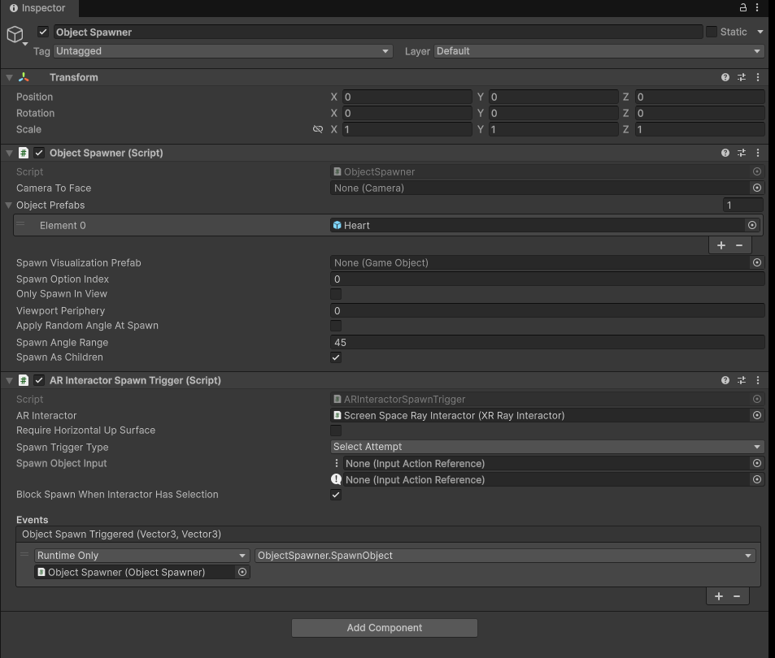

# Unity 01 – World AR: place a heart

**What you will build:** Click a surface and a 3D human heart appears on it.
**AR type:** Markerless (surface detection)
**Time:** about 25 minutes. **Code:** none

Do [00 – Set up](00-setup.md) first.

## Step 1 – Open your starter scene

Open `Assets/Scenes/01-World-AR` in the `xr-course` project.

> Need to compare with the finished version? Open `Assets/Completed/Scenes/01-World-AR-Completed`.

## Step 2 – Make the heart prefab

1. In the **Hierarchy**, right-click > **Create Empty**. Name it `Heart` and set its Position to `0, 0, 0`.
2. From `Assets/Shared/Models`, drag `heart` **onto** the `Heart` object, so it becomes its child. Rename the child `Model`.
3. Set the `Model` Transform. **1 unit is 1 metre**, and these numbers make the heart 15 cm tall.

| Setting | Value |
|---------|-------|
| Position | 0, 0.074, 0 |
| Scale | 4.67, 4.67, 4.67 |

4. Create a material (e.g. in a `Materials` folder) and assign the texture maps from `Assets/Shared/Textures/Heart/`, then drag the material onto the heart in the Scene view.
5. Select the parent `Heart` and use **Add Component** to add these:

| Component | Setting | Why |
|-----------|---------|-----|
| **Box Collider** | Center `0, 0.075, 0`, Size `0.1, 0.15, 0.08` | So touch can find the heart |
| **XR Grab Interactable** | A **Rigidbody** is added for you: tick **Is Kinematic**, untick **Use Gravity** | So you can select it and it does not fall |
| **AR Transformer** | Leave as it is | Move, rotate and scale by touch |

6. Drag `Heart` from the Hierarchy into a `Prefabs` folder (e.g. `Assets/Prefabs`) to save it as a **prefab**, then delete `Heart` from the Hierarchy.

## Step 3 – Give the prefab to the Object Spawner

1. Select **Object Spawner** in the Hierarchy.
2. Set **Object Prefabs** to size `1` and drag your `Heart` prefab into the slot.
3. Set **Spawn Option Index** to `0`.

## Step 4 – Press Play

1. Press **Play** and click the **Game** tab.
2. Hold the **right mouse button** to look around. Walk with **W A S D**.
3. Wait until the surface shows dots, then click it. The heart appears.

On a phone you can also drag to move it, twist with two fingers to rotate it and pinch to scale it.

## Step 5 – Add Android back gesture to exit (for phone builds)

Follow [03 – Android back gesture](03-android-back-exit.md) to add `AndroidBackToQuit` to **AR Session** so swiping back on Android closes the app.

## Test on a phone (optional)

- **Android:** connect the phone with USB debugging on. In **File > Build Profiles** choose **Android** > **Switch Platform**, add this scene with **Add Open Scenes** (untick any others), then **Build and Run**.
- **iPhone:** on a Mac, choose **iOS**, add the scene, **Build**, then run the result from Xcode.

## Troubleshooting

| Problem | Fix |
|---------|-----|
| The heart is huge or tiny | Check the `Model` scale is 4.67 and the parent `Heart` scale is 1 |
| The heart is white | Assign your material with the Heart texture maps onto `Model` |
| Clicking does nothing | Check the prefab is in **Object Prefabs** and you clicked on the dots |

## Credits

"Realistic Human Heart" by neshallads on Sketchfab, licensed under [CC Attribution 4.0](http://creativecommons.org/licenses/by/4.0/).
