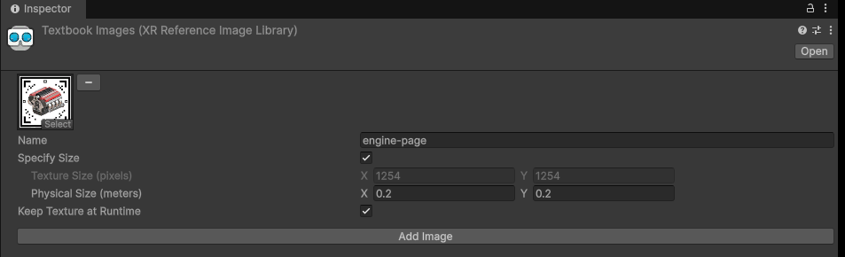
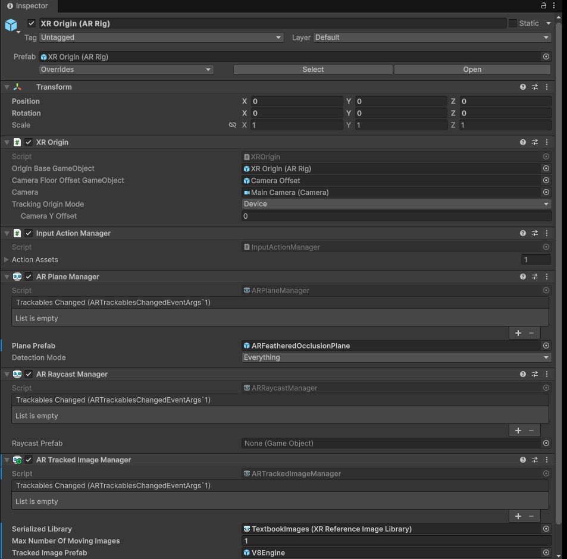

# Unity 02 – Image marker AR: textbook pop-up

**What you will build:** Point the camera at a printed page and a V8 engine appears on it.
**AR type:** Image tracking
**Time:** about 20 minutes. **Code:** none

Do [00 – Set up](00-setup.md) first.

## Step 1 – Open your starter scene

Open `Assets/Scenes/02-Image-Marker` in the `xr-course` project. Keep the word **Marker** in the scene name: it tells the simulator to put the page on the table.

> Need to compare with the finished version? Open `Assets/Completed/Scenes/02-Image-Marker-Completed`.

## Step 2 – Prepare the prefab

Create a `V8Engine` prefab from `Assets/Shared/Models/v8-engine.fbx` with a material using the textures in `Assets/Shared/Textures/V8Engine/`. (To inspect the finished setup for comparison, double-click `V8Engine` in `Assets/Completed/Prefabs/`.)

## Step 3 – Make the image library

This is the list of pictures the app looks for.

1. Right-click in the **Project** window > **Create > XR > Reference Image Library**. Name it `TextbookImages`.
2. Click **Add Image** and drag `engine-marker` (in `Assets/Shared/Textures`) into the slot.
3. Tick **Specify Size** and enter `0.2` by `0.2`. This is the printed size in metres.

## Step 4 – Give the library and prefab to AR Tracked Image Manager

1. Select **XR Origin (AR Rig)** — it already has **AR Tracked Image Manager** attached (or add it with **Add Component** if creating a scene from scratch).
2. Drag your `TextbookImages` library into **Serialized Library**.
3. Set **Max Number Of Moving Images** to `1`.
4. Drag the `V8Engine` prefab into **Tracked Image Prefab**.

## Step 5 – Press Play

Press **Play** and wait a few seconds. The engine appears on the page on the table. Hold the **right mouse button** to look around and walk with **W A S D**.

## Step 6 – Add Android back gesture to exit (for phone builds)

Follow [03 – Android back gesture](03-android-back-exit.md) to add `AndroidBackToQuit` to **AR Session** so swiping back on Android closes the app.

## Test on a phone (optional)

Print [engine-marker.png](images/02-image-marker/engine-marker.png) 20 cm wide, or show it on another screen. Then build as in [01 – World AR](01-world-ar.md), adding this scene.

## Make it your own

Use your own picture (one with lots of detail) and your own prefab. The steps are the same.

## Troubleshooting

| Problem | Fix |
|---------|-----|
| Nothing appears | Check the library and prefab are assigned, and the scene name contains `Marker` |
| The size is wrong | Check **Specify Size** matches the printed picture |
| You cannot see the page | Walk towards the table with **W A S D** |

## Credits

"V8 Engine" by little.bucket on Sketchfab, licensed under [CC Attribution-NonCommercial 4.0](http://creativecommons.org/licenses/by-nc/4.0/). Non-commercial use only.
